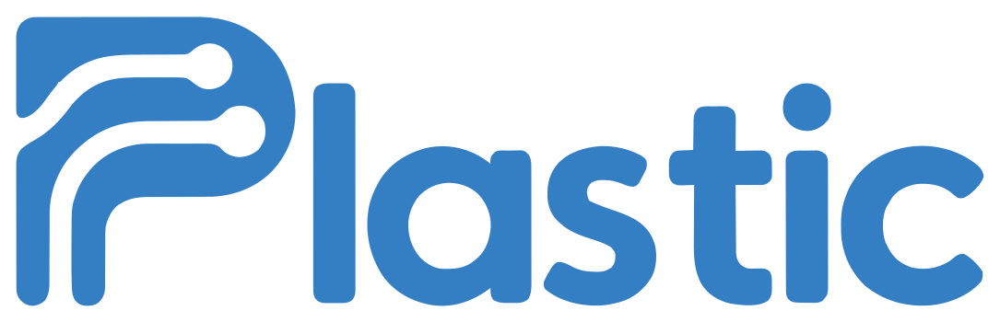
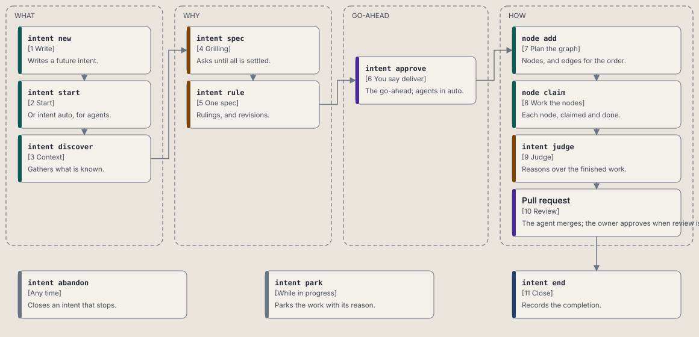

<h1 align="center">
  
</h1>

<p align="center">
  <strong>One command that turns an intent into a durable, linked record of decisions, plans, delivery and outcomes</strong>
</p>

<p align="center">
  <a href="https://github.com/zalom/plastic/actions/workflows/test.yml"></a>
  <a href="https://github.com/zalom/plastic/releases"></a>
  <a href="LICENSE"></a>
</p>

<p align="center">
  <a href="#installation">Install</a> &bull;
  <a href="#quick-start">Quick start</a> &bull;
  <a href="docs/usage/commands.md">Commands</a> &bull;
  <a href="docs/reference/commands/README.md">Command reference</a> &bull;
  <a href="docs/contributing/ARCHITECTURE.md">Architecture</a> &bull;
  <a href="MANIFESTO.md">Manifesto</a>
</p>

---

Plastic is an intent-based system for AI-assisted work. You do not always start with a task.
You start with an intent, such as "I want users who are locked out to recover access safely."
Plastic carries that intent through four stages, What, Why, How and Exec, and leaves a
readable record of how the idea became real.

Plastic is named after neuroplasticity, the brain's ability to change as it learns.

## What Plastic does

Plastic keeps the shape of the work fixed and leaves the thinking to you and your agent.

| You want to | What Plastic does |
|-------------|-------------------|
| Start from a rough idea | Creates one intent with an id and a slug: its rows and its folder |
| Keep the reasons | Appends each ruling to the Insights section of the intent file |
| Plan the work | Holds the plan as a graph of nodes, and names the nodes ready to claim |
| Resume tomorrow | Prints where a project stands and the next action in one line |
| Hand work to agents | Prints the brief an agent starts from, and records each node's report |
| Close the work | Closes a delivered intent once its verdict, nodes and outcome allow it, or prints what is missing |
| Find an old decision | Searches every store, ranked, with one excerpt for each match |
| Run many projects | Keeps one store for each project, plus a global store: SQLite databases, printed to plain Markdown |
| Steer a long delivery | Reads the `needs` links between intents and prints the first ready intent |
| Protect the record | Copies one store's databases into a new backup folder, and puts a backup back |

Every result ends with a `next:` line and a `because:` line. The `--json` option prints the
same result as data with stable keys. Every command takes it except the installer commands
(`install`, `update`, `uninstall`, `rollback`) and `plastic hook EVENT`, which runs a hook
script for the harness.

## How the record is built

Each intent is one set of rows in the store's databases, printed to one folder. Its record grows
from the original intention through decisions, a plan of dependent nodes, and delivery.

| Stage | Question | File on disk |
|-------|----------|--------------|
| What | What is the intention? | `intent.md` |
| Why | What context, evidence, and decisions shape it? | `spec.md`, `context.json` |
| How | What is the plan? | `graph.json` |
| Exec | What happened, and what was delivered? | `work.log`, `outcome.md` |

`graph.json` prints the nodes and the edges between them. Plastic reads the node states and the
edges to determine which work is ready, and `plastic graph ready ID` lists the nodes ready to
claim. `plastic next` picks the intent in play and offers its next command.

The printed files are plain Markdown and JSON in a folder that you own. See
[the architecture](docs/contributing/ARCHITECTURE.md) for the full store layout.

## Installation

Plastic needs Ruby 4.0 or later, git, curl, tar, and `sha256sum` or `shasum`. `install.sh` checks
for each and names what is missing. It runs on macOS and Linux. On Windows, install Plastic inside
WSL; there is no native Windows install.

```bash
curl -fsSL https://raw.githubusercontent.com/zalom/plastic/main/install.sh | sh
plastic init
```

`install.sh` needs Ruby 4.0 or later and git, and stops with the steps to install what is missing.
It downloads the newest stable release, checks it against its published checksum, and links
`~/.local/bin/plastic`.
`plastic init` lists the agent harnesses it finds, Claude Code, Codex CLI and Hermes, each one picked,
and installs Plastic into the ones you pick. [Enola](INSTALL.md#enola) is an optional tool that
maps code architecture.

### A clean Mac

The Ruby 2.6 that macOS ships is too old. Run `brew install ruby` and put its `bin` folder on your
`PATH` first; [INSTALL.md](INSTALL.md) has the lines.

### Check the installation

```bash
plastic version     # The version and the release channel
plastic doctor      # The installation, the databases and the hooks of this agent
```

`plastic version`, or `plastic --version`, prints the version, the release channel and the file the version came from.
It changes nothing.

`plastic doctor` checks the releases, the launcher on your `PATH`, the Ruby version, the sqlite3
bundle, where the hooks point and the installer lock. It also opens each database and reads the hooks and instruction files of the
agent it runs in. It prints one row for each check, then the repair for each finding, and exits
1 when it finds a problem. It also rebuilds a search index that is out of step with the documents.

### Move from npm

To move an npm installation to the shell launcher, run `install.sh` once. It points the hooks
at the new launcher and keeps your stores and settings. See
[INSTALL.md](INSTALL.md#move-from-npm) for the details.

[INSTALL.md](INSTALL.md) covers update, rollback, uninstall and the supported platforms.

## Quick start

```bash
# 1. Install for your agent
curl -fsSL https://raw.githubusercontent.com/zalom/plastic/main/install.sh | sh
plastic init                # Pick the agents to install into

# 2. Register your repository as a project
plastic project new blog ~/code/blog

# 3. See what is open
plastic status

# 4. Open an intent and start it
plastic intent new "Add a --version flag"
plastic intent start 1

# 5. Ask what to do next, at any time
plastic next
```

`plastic project new` registers the repository, makes its store, and writes an `AGENTS.md` and a
`CLAUDE.md` into it when they are missing. `plastic intent start` prints the worktree to create and
asks you to run it again once it exists.

Restart your agent after the install. [The command list](docs/usage/commands.md) shows the commands
by task, and the [command reference](docs/reference/commands/README.md) has a page for each.

## How it works

An intent moves through the phases below: the go-ahead, the nodes, the judge, the close and the abandon.



```
  You or your agent              plastic                     ~/.plastic/stores/SLUG/store
  -----------------              -------                     ----------------------------
  plastic intent new "..."  -->  creates the intent     -->  12--slug/intent.md
  plastic intent rule 12    -->  records a ruling       -->  Insights in 12--slug/intent.md
  plastic next              -->  names the next step    -->  graph.json, printed from the node rows
  plastic intent end 12     -->  closes the intent      -->  outcome.md, store/index.json

        ^                                                              |
        |            next: one command       because: one reason       |
        +--------------------------------------------------------------+
```

Plastic follows four rules:

1. **Commands print state and rules.** The judgment stays with you and the agent.
2. **The work log is append-only.** `work.log` holds one line for each step, so a new
   session resumes from the last line.
3. **Status is derived.** Plastic reads what is ready from the node rows and their edges.
4. **Nothing leaves the machine.** Plastic makes no model call and sends none of your files anywhere.

## Supported AI tools

| Tool | Install | State |
|------|---------|-------|
| **Claude Code** | `plastic init` | Supported |
| **Codex CLI** | `plastic init` | Supported |
| **Hermes** | `plastic init` | Agents only, with no hooks |

The `plastic` command itself needs no agent. It runs in any shell with Ruby. See
[harness support](docs/reference/harness-adapters.md) for the detail on each agent.

Four agents ship with Plastic: a planner that drafts or reviews a plan, an executor that
builds it, and two advisors for hard decisions. Your main session dispatches each one for one
step and records what it reports.

## Configuration

`plastic config list` prints every setting and `plastic config set KEY VALUE` writes one. [The features page](docs/usage/FEATURES.md#settings) says what each setting does.

## Uninstall

```bash
plastic uninstall     # Remove what Plastic wrote into the agents you pick
```

The uninstall removes what the record of each agent lists, so your own settings stay. Your
stores under `~/.plastic` stay.

## Documentation

- **[INSTALL.md](INSTALL.md)**: every install path.
- **[docs/reference/commands/](docs/reference/commands/README.md)**: one page for each `plastic` command.
- **[docs/usage/](docs/usage/FEATURES.md)**: features, [the command list](docs/usage/commands.md), the audit guide and tracking.
- **[Drive a graph from any harness](docs/usage/drive-from-any-harness.md)**: the loop a script or an SDK runs to work a graph.
- **[docs/contributing/](docs/contributing/ARCHITECTURE.md)**: the system architecture in drawings, the command architecture, the coding practices, the gates and the [release lines](docs/release-lines.md).
- **[CHANGELOG.md](CHANGELOG.md)**: one entry for each release.

## Privacy

Plastic runs on your machine. It makes no model call and sends none of your files anywhere.
Two things use the network: `install.sh` and `plastic update`. They read the release list from
GitHub and download a release from there. Bundler fetches the sqlite3 and tty-prompt gems
from RubyGems when a release installs. See [SECURITY.md](SECURITY.md) for every file the installer writes.

## Built with Plastic

Plastic is developed through Plastic. The intents, the plans, the decisions and
the outcomes behind each release are part of the record.

## Contributing

See [CONTRIBUTING.md](CONTRIBUTING.md).

## License

MIT. See [LICENSE](LICENSE).
