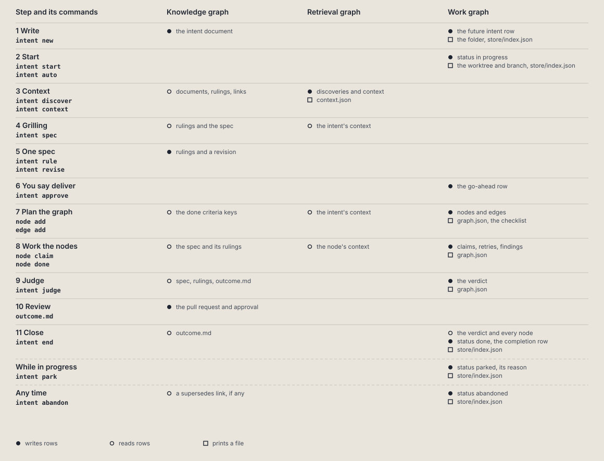

# Architecture

This page is the map of Plastic. Each section opens with a drawing, and the tables under it
name the parts. The drawings are generated: rebuild them with `ruby bin/architecture-figures`
after a change to the system, and commit the files in `docs/contributing/figures/`.

## The system and what it talks to


| Actor | What it is | What passes between it and Plastic |
| ----- | ---------- | ---------------------------------- |
| Owner | The person who decides what to build. | Goals, answers to questions and the go-ahead to deliver. The owner reviews the pull request when review is on. |
| Agent harness | Claude Code or Codex. | The harness runs `plastic` commands and fires the hook events. |
| Project repositories | The code of each project. | Plastic reads where each project lives from `projects.yml`. The agent edits the code in a worktree made for each intent. |
| GitHub | The host of the pull request and of CI. | The agent pushes a branch and opens the pull request. Plastic runs no `git` command. |

## What runs and where it keeps data


One program, `active/bin/plastic` of the install, serves every command and the three hooks.
Everything it keeps lives under the Plastic home.

| Place | Holds |
| ----- | ----- |
| `~/.local/share/plastic/` | The install: `active/bin/plastic`, the program; `releases/VERSION/`, one folder for each release; and `download/`, the files `plastic update` fetched. Each release runs on the Ruby that was on the `PATH` at install. `~/.local/bin/plastic` links to the program. |
| `exe/plastic` | In the home, the launcher the non-release hooks run. |
| `PLASTIC.md` | The always-on instructions that the harness imports. |
| `plastic.db` | What belongs to one machine: `command_runs`, `sessions`, the `settings` rows, the hash of each file printed from them, and `store_migrations`, the ledger of the migrations of each store. |
| `config.yml`, `projects.yml` | The settings, printed from the `settings` rows, and the list of projects from slug to repository. |
| `installations/` | One install record for each harness Plastic is installed into: every file, folder, setting and section the install wrote, which `plastic uninstall` takes out. |
| `stores/SLUG/` | One store for each project, plus the global store. |
| `stores/SLUG/backups/` | Copies of the work and knowledge databases, one folder for each backup. |
| `store/index.json` | Every intent, cluster and link of the store in Luhmann order. It carries no print time. |
| `roadmaps/` | One markdown file for each roadmap, printed from the rows. |
| `store/ID--slug/` | An intent folder: `intent.md`, `spec.md`, `graph.json`, `work.log`, `outcome.md` and `context.json`, printed from the rows. |

A store keeps its rows in three SQLite databases: work, knowledge and retrieval. A fourth, `legacy.db`, keeps what a migration removed. The store folder's `.gitignore` lists them,
so they are never versioned. The files printed from them are.

| Database | Tables |
| -------- | ------ |
| `work_graph.db` | `nodes`, `edges`, `work_log`, `roadmaps`, `batches`, `roadmap_items`, `roadmap_edges`, `roadmap_log`, `runs` |
| `knowledge_graph.db` | `intents`, `clusters`, `completions`, `approvals`, `verdicts`, `archives`, `archive_entries`, `documents`, `legacy_intents_data`, `document_heads`, `rulings`, `links`, `retrieval_contexts`, `retrieval_discoveries` and `sqlar`, the intent files that the sync rules of the machine read |
| `retrieval_graph.db` | `document_passages`, `document_fts`; derived from the knowledge rows, outside the backups and rebuilt by `plastic doctor` |
| `legacy.db` | The rows a migration removed, in tables named for the live table and the version, such as `sqlar_20261119000000`, and the old text of each value a migration rewrote, in `changed_values_VERSION`; made by the first migration that keeps rows or values, and read only by `plastic migration down` and `plastic migration purge` |

The `printed` table, in `plastic.db` and in `knowledge_graph.db`, keeps the hash of every file printed from the rows,
as of the last print. No table logs the history of a row.

A node move writes four kinds of row in one transaction: the node's state, its run, the log line
and the changed files of the intent folder it read.

Every row carries `origin_id`, the id of the installation that wrote it. The id sits in a file
at the home and is made on first use.

Every time Plastic stores is UTC, written as ISO 8601 with `Z`, such as `2026-11-21T09:00:00Z`.
This holds for every database row and every printed file, and one writer makes the text:
`Plastic.timestamp` in `lib/plastic/clock.rb`. A time shown to a person, in a command's output or
a hook's reply, is converted to the zone of the machine when it is printed, with its offset, such
as `2026-11-21T10:00:00+01:00`. `Plastic.local` does that conversion, and `--json` carries the same
text as the screen. The zone is the one `TZ` names, or the zone of the system; no setting changes
it. A date with no time, such as the day an intent opened, stays a date. So a store restored on a
machine in another zone keeps its times in order, and shows them in that machine's zone.
A backup belongs to the calendar day of the machine on which its UTC time falls.

An intent row has its number in `id`, its Luhmann id in `intent_id`, the Luhmann id of its
parent in `parent_id`, and an optional `ref` to an intent it follows. Its status is one of six:
open, in_progress, parked, future, done or abandoned. The states fall in three groups: active
(open, in_progress and parked), future, and finished (done and abandoned). A parked intent holds the
`reason` it waits. `plastic intent new` writes a future intent and `plastic roadmap open` an open one.
`plastic intent start` or `plastic intent auto` sets it in progress, `plastic intent park` parks it
with its reason, and `plastic intent end` or `plastic intent abandon` finishes it.

## The components of the kernel

![The components of the plastic kernel. CLI finds the row in CLI::TABLE and builds the command, a Routine or a CLI::Hook. The Routine walks a chain of workflows with Routine::Traversal, which looks each workflow up in Workflows::REGISTRY, where a CodeWorkflow or an AgentWorkflow is held. The Routine opens the Graph: Graph::WorkGraph writes, Graph::RetrievalGraph reads, Graph::Printer prints. Graph::WorkGraph writes the four databases through Graph::Writers and Graph::Database, and Graph::RetrievalGraph reads them.](figures/components.svg)

The kernel lives under `lib/plastic/`, and `lib/plastic.rb` loads it. A class
loads on first use, so `plastic help` reads the table and loads no command.

| Component | File | What it owns |
| --------- | ---- | ------------ |
| `CLI` | `lib/plastic/cli.rb` | Finds the longest entry in the table that starts the arguments, answers `--help`, and names an unknown command and points at `plastic help`. |
| `CLI::TABLE` | `lib/plastic/cli/table.rb` and `lib/plastic/cli/table/work_families.rb` | The whole command line in one frozen hash: the words, the class and the help line. The work graph and hook families are written in `work_families.rb`, and `table.rb` adds them in order. |
| `CLI::Command` | `lib/plastic/cli/command.rb` | The base class. It parses the arguments, runs the call, prints and maps errors to exit codes. |
| `Scope` | `lib/plastic/scope.rb` | Which project and store a command works on. |
| `CLI::Output` | `lib/plastic/cli/output.rb` | Prints rows, the `next:` and `because:` lines, and the `--json` form. |
| `Routine` | `lib/plastic/routine.rb` | A command whose work is a chain of workflows, written as data in the class body. |
| `Routine::Chain` | `lib/plastic/routine/chain.rb` | The workflow keys in order and the edges between them. It lists every wiring fault at once. |
| `Routine::Traversal` | `lib/plastic/routine/traversal.rb` | One pass along a chain. It runs each workflow and follows the edge its outcome takes. |
| `CodeWorkflow` | `lib/plastic/code_workflow.rb` | Ruby steps that run in order: gates, reads and steps. It returns an outcome name. |
| `AgentWorkflow` | `lib/plastic/agent_workflow.rb` | Steps in plain words for the agent. It hands off while any step is left undone. |
| `Workflows::REGISTRY` | `lib/plastic/workflows/registry.rb` | Every workflow key, mapped to the class path of its workflow: `:code_start_intent` is `Workflows::Code::Intent::Start`, in `lib/plastic/workflows/code/intent/start.rb`. |
| `Context`, `Facts` | `lib/plastic/context.rb`, `lib/plastic/facts.rb` | The named values of one call. A name that no one declared raises at once. |
| `CommandRun` | `lib/plastic/command_run.rb` | One call of one tool on one subject, kept as a row of `plastic.db`. |
| `CLI::Hook` | `lib/plastic/cli/hook.rb` | The base class of a hook command. It prints a plain text reply and always exits 0. |
| `Hooks::Recap`, `Hooks::StopGate` | `lib/plastic/hooks/` | The text `hook start` prints and the decision whether `hook stop` blocks a stop. |
| `Harnesses`, `Harnesses::Detection`, `Harnesses::Innermost` | `lib/plastic/harnesses.rb`, `lib/plastic/harnesses/` | The harness registry: for each harness its settings folder, session variable, transcript path, process name, hook events and doctor checks. `plastic init` lists the harnesses whose folder or program it finds. Detection names the harness of a start hook, and `Innermost` picks the session of the inner harness when one runs inside another. |
| `Installations` | `lib/plastic/installations.rb`, `lib/plastic/installations/` | The install records: `Recording` writes one when an install finishes, and `Removal` takes out exactly what one lists. `Installations::HookEntries` holds the hook entries the installer writes for Claude Code and Codex. |
| `Config`, `Config::Rows`, `Config::Store` | `lib/plastic/config.rb`, `lib/plastic/config/` | The settings read in layers from the `settings` rows: the shipped defaults, the `global` rows, then the rows of the harness. `Store` writes one row and prints `config.yml` from the rows, and refuses a file changed by hand since the print. |
| `Graph::Database` | `lib/plastic/graph/database.rb` | One SQLite file, read and written through the `sqlite3` gem. A write is one transaction and logs its `changes` row. |
| `Graph::WorkGraph` | `lib/plastic/graph/work_graph.rb` | The writes of a command: command runs, sessions, intents, nodes, runs and edges. |
| `Graph::RetrievalGraph` | `lib/plastic/graph/retrieval_graph.rb` | The reads of a command, one table at a time. |
| `Graph::Printer` | `lib/plastic/graph/printer.rb` | Prints files from their rows and records each hash in `printed`. |
| `Graph::Knowledge::Sync` | `lib/plastic/graph/knowledge/sync.rb` | Compares each file, its rows and its last print, and plans and applies a sync. |

`Plastic.now` is the one source of the time. A command receives its streams, environment, home
directory and working directory as arguments. No command reads `ENV`, `Dir.home` or `$stdout`
directly, so a test never touches the real store.

Every table is declared once, in `lib/plastic/graph/db/schema.rb`. The class in
`lib/plastic/graph/db/schema_file.rb` builds the table definitions from it, and `Graph::Schema` serves their DDL, so nothing else
declares a table. `test/plastic/graph/db/schema_test.rb` pins the DDL of each table by hash.
Two marks sit on a table:

| Mark | Meaning |
| ---- | ------- |
| `legacy: true` | The table holds old data that nothing new reads. |
| `since: VERSION` | Databases older than VERSION lack the table. The next open creates it, so the backup check and `plastic doctor` do not fail on its absence, and the doctor notes it. |

To retire a kind of data:

1. Mark its table `legacy: true` in the schema file.
2. Stop writing it from new code and stop reading it, except in the plumbing that writes,
   prints, counts and declares it.
3. Add its name to the allowed list of `test/legacy_tables_guard_test.rb` only for that plumbing.
4. Leave its DDL unchanged. A legacy table is never dropped.

## The three graphs


`Graph::WorkGraph` is the write side of every database. `Graph::RetrievalGraph` is the read side:
it reads every database and writes nothing. The commands below reach them through these two.

| Graph | Database | What it holds | Written by | Read by |
| ----- | -------- | ------------- | ---------- | ------- |
| Work graph | `work_graph.db` | What is being built: nodes and the edges between them, the work log and runs, roadmaps. | `Graph::WorkGraph` | `plastic next`, `plastic intent show` |
| Knowledge graph | `knowledge_graph.db` | What is known: the current text of each document, rulings and links. | `plastic intent new`, `plastic intent rule`, `plastic sync up` | `plastic search`, `plastic intent spec` |
| Retrieval graph | `retrieval_graph.db` | What is found: the passages and the search index over the documents. | `plastic sync up` | `plastic search` |


A node is one unit of work. It moves through `open`, `claimed`, `done`, `failed`,
`needs_info` and `impeded`, or leaves the graph as `removed`. `Graph::Work::Node::Writer` owns
the moves, and each move is a guarded `UPDATE`, so two attempts on one node cannot both win.
The fourth claim of a node that keeps failing moves it to `needs_info` with a standing question.
An edge says one node needs another. `Graph::Work::Edge::Writer` refuses a self edge, an edge to
a missing or removed node, and an edge that would close a loop.

| Move | Command |
| ---- | ------- |
| Add or remove a node | `plastic node add`, `plastic node remove` |
| Take or give back a node | `plastic node claim`, `plastic node release` |
| Finish or fail a node | `plastic node done`, `plastic node fail` |
| Ask the owner, stop, or reopen | `plastic node ask`, `plastic node impede`, `plastic node resolve` |
| Wire the order | `plastic edge add`, `plastic edge remove` |

Every plan follows the Principle of Least Surprise. An ambiguity gets research and then
`plastic node ask`. A blocker stops its node with `plastic node impede`. A newly found issue
becomes `plastic node add` plus `plastic edge add`. `Graph::Work::PlanningDirective` holds the
text that Plastic prints in the planning hand-off.

## How an intent is delivered


| Step | Command | What it writes |
| ---- | ------- | -------------- |
| Write | `plastic intent new` | The future intent row and its folder. |
| Start | `plastic intent start` or `plastic intent auto` | The intent in progress, for guided work or agent delivery. |
| Context | `plastic intent discover` | The context the intent starts from. |
| Grilling | `plastic intent spec` | Nothing. It prints the method and the open decisions. |
| One spec | `plastic intent rule`, `plastic intent revise` | A ruling, or a new revision of the What and the Why. |
| Go-ahead | `plastic intent approve` | The approval row: the owner gives it in guided work, and the agents record it in auto. `plastic node claim` refuses without it. |
| Plan the graph | `plastic node add`, `plastic edge add` | Nodes and edges, and `graph.json`. |
| Work the nodes | `plastic node claim`, `plastic node done` | Each node's claim and run, then its findings. |
| Judge | `plastic intent judge`, `plastic intent verdict` | The verdict row. |
| Review | The pull request | The `Pull request:` and `Approved:` lines of `outcome.md`, which `plastic sync up` reads into the rows. The agent merges; the owner approves when review is on. |
| Close | `plastic intent end` | The completion row. |
| Park | `plastic intent park` | The parked status and its reason, while the intent is in progress. |



`plastic intent start ID` and `plastic intent auto ID` set the intent in progress and print its worktree.
They end on `plastic intent spec ID` for an open decision, no done criterion, or a missing go-ahead.
They take no lock.
`plastic node claim` fails for an intent that is not in progress, and refuses with exit 3 one
without the go-ahead. A node claim names the session that
holds the node and lapses after 900 seconds without a renewal; each command of the session and
`hook stop` renew it. Plastic computes the path
and branch of the code worktree, `<repo>/.claude/worktrees/ID--slug` on `plastic/ID--slug`, and
prints them. The agent makes the worktree.

A driver outside the session can run the same steps. `Graph::Work::Packet` builds the claim's packet from the retrieval graph, and `Graph::Work::Schemas` finds the schema file of a node at `resources/tmp/schemas/NODE.json`. Plastic names the file and never checks JSON against it: the harness does. `NodeOutput` reads the file that `plastic node done --output` stores. [Drive a graph from any harness](../usage/drive-a-graph.md) shows the loop.

`plastic intent end ID` takes no options. It closes the intent when every live node is done,
every criterion key of `spec.md` is covered by a done node, the latest verdict is `accept` and
is newer than the last node change, and `outcome.md` has a `## Verification` section with one
delivery line: `Merged:` for a merged pull request or `Committed:` for a direct commit, each with
an `Architecture map:` line, or `Delivered:` for files in the intent folder under
`resources/output`, which needs no map. `Workflows::Agent::Intent::End::CheckDelivery` hands the
agent the steps for a delivery line that is missing or refused. When review by pull request is on (the default is off), the section
also has a `Pull request:` line, and an `Approved:` line once the owner approves. Closing
hands the agent the wind-down steps in `Workflows::Agent::Shared::WindDownIntent`.
`plastic intent abandon ID` hands the agent the revert steps in `Workflows::Agent::Intent::Abandon`, then
closes the intent as abandoned, with the disposition `superseded` when another intent supersedes it, or `cancelled`.

## One command from call to report


`exe/plastic` runs the dispatcher. It finds the command in the table, prints the usage line on
`--help` without running it, or builds the command and sends it `call` and then `flush`.
The `call` method does the work, and `flush` prints the report or its `--json` form.

A routine names its chain in its class body. Each `workflow` line gives a key and the edge that
each outcome takes. The key `:noop` ends the chain.

```ruby
workflow :code_check_write_lock, next: :code_check_ending
workflow :code_check_ending do
  on :written, next: :code_close_intent
  on :missing, next: :agent_write_outcome
end
```

`Routine.verify` checks the chain once per process, before the first workflow runs. It raises
one error that lists every fault: an edge that points backward or to an unknown key, a
workflow no edge reaches, an outcome with no edge, an agent workflow that is not last, an
ending with no `because:` line, and a printed line that names an undeclared fact.

A call ends in one of four values. Each value prints its own last lines and gives the exit code,
so no workflow picks a number.

| End value | Meaning | Exit code |
| --------- | ------- | --------- |
| `Finished` | The chain ended. | 0 |
| `HandedOff` | The agent has steps to do. The next call picks up where this one stopped. | 0, or 1 when the handoff stops as a failure |
| `Failed` | A step broke. | 1 |
| `Refused` | A step belongs to the owner. | 3 |

A usage error exits 2. A command raises, and the `run` method maps the error: `Failure`
gives 1, `Usage` and an unknown project give 2, and `Refusal` gives 3.

### The command run row

A command run is one call of one tool on one subject. A tool that writes keeps it as a row of
`command_runs` in `plastic.db`, keyed by the store, the tool and the subject. A tool that writes
nothing keeps it in memory. The traversal saves the row after each workflow and again when the
call ends.

| Status | What it means | What the next call does |
| ------ | ------------- | ----------------------- |
| `running` | The process is inside the chain, or it died there. | Starts again at the first workflow. |
| `handed_off` | The agent has steps to do. | Reads the saved facts and checks the steps again. |
| `failed` | A step broke. | Retries the workflow that broke. |
| `refused` | The owner holds a step. | Asks again. |
| `finished` | The chain ended. | Starts a new command run. |

A step that changes state has a done check, so a change that already happened is skipped and
never runs twice.

### The hook reply

A hook is a command that the harness calls on an event. It is not a routine: it prints no
`next:` line and keeps no command run. It reads the event as JSON on stdin, prints a plain text
reply, and always exits 0. On an error it prints one line on stderr and still exits 0, so a
broken hook never breaks the session. A hook takes no harness option: the start hook names the
harness from the event, the session variables, the transcript path and the process tree, in that
order, and later hooks read it from the session row.

| Event | Command | What it does |
| ----- | ------- | ------------ |
| Session start: a new session, a clear or a compaction | `plastic hook start` | Names the harness, records it on the session row, and prints the open intents, the previous session, the intent in progress with its last work log lines, and the note; the compact print adds `note: TEXT` before the `next:` line. |
| End of a turn | `plastic hook stop` | Stamps the session's last turn, renews its node claims, and runs the stop gate with the settings of the harness the session row names. |
| Session end | `plastic hook end` | Sets the end time and the reason. |
| Every other event | Nothing | No hook runs. |
| Message display (Claude Code) | The screens launcher | Paints the screens when the setting `screens` (set with `plastic config set KEY VALUE`) turns them on. |
| Status line (Claude Code) | The statusline launcher | Prints the status line when the setting `statusline` (set with `plastic config set KEY VALUE`) turns it on. |

### Sync

`plastic intent new` writes an intent's rows and prints its folder in the same call. The two
sync commands keep the files and the rows level after a hand edit. Three hashes decide what
happens to each file: the file on disk, the text printed from the rows now, and the last print
that `printed` records.

| The file and its rows | `sync up` | `sync down` |
| --------------------- | --------- | ----------- |
| The file equals its rows. | Records the hash when it is new. | Records the hash when it is new. |
| Only the file changed. | Reads the file into its rows. | Leaves the file. |
| Only the rows changed, or the file is missing. | Leaves the rows. | Prints the file. |
| Both changed. | A conflict. | A conflict. |

A plain sync with a conflict writes nothing, exits 3 and lists every conflict. With
`--overwrite PATH`, the file at that path takes the side of the command: `sync up` keeps the
file, and `sync down` keeps the rows. `--overwrite` alone does the same for every conflict.
`--merge` applies the one-sided changes, then exits 3 and lists the conflicts left.

A sync reads only the files that `Graph::Knowledge::SyncSelection` selects. Other files stay on
disk and get no rows.

| Place in an intent folder | Files | Read |
| ------------------------- | ----- | ---- |
| Intent root | Every Markdown file, `graph.json`, `context.json`, `work.log` and the legacy plan, checklist and `actions/` files | Always |
| `resources/output/reports/` | The recorded reports and the reports the config makes mandatory | A file of an included type, only when `plastic intent report` recorded it or `reports.mandatory` names it |
| `resources/output/files/` | Files of an included type | By `sync.types`, Markdown and HTML by default. `plastic init` offers images and videos picked. |
| `resources/references/` | Copies of outside material | When `sync.references` is on |
| `resources/tmp/` and every other place | Tool output, packets, plans, notes and every other file | Never |

A sync up skips the first file of a type that `sync.types` and `sync.asked` do not name, prints one
line that names the `plastic config set` command adding the type to `sync.types`, and adds the type to
`sync.asked`.

A file the selection leaves out is not read, even when an earlier sync put it in rows. A sync up
removes the rows of such a path: `documents`, `document_heads`, `printed`, `document_passages` and
`document_fts`. `Graph::Knowledge::Reports` answers whether a report is recorded, from the
`reported` lines of the work log, or mandatory, from `reports.mandatory`.
Its rows stay, and nothing on disk is removed.

A change row in `changes` holds the table, the key, the operation, the time and the origin of a
write, never a copy of the row.

`plastic sync up` reads every intent folder of a store. A folder with no row gives a row built
from its intent file. A folder that cannot give a row is named with its reason, and the call
exits 1. A command that declares `previews` takes `--dry-run`: `Graph::DisposableCopy` runs the
whole chain against a temporary copy of the store and prints what the call would change.

## Roadmaps, links, archive and backup

A roadmap is a plan of several intents, kept as rows in `work_graph.db`. It holds batches. Each
batch has a goal and done criteria, and each item can need other items. `plastic roadmap new`,
`plastic roadmap batch` and `plastic roadmap add` write the plan. `plastic roadmap open` opens a
ready item's intent and copies the item's goal and done criteria into its spec. An item's state
is never stored: it is derived on each read as done, dropped, in flight, blocked or ready.
`plastic roadmap next` prints the first ready item, and `plastic roadmap check` names a cycle.

| Command | What it does |
| ------- | ------------ |
| `plastic intent link` | Writes a typed link from one intent to another. A link to a live intent stops that intent from being archived. |
| `plastic intent archive ID` | Saves the whole intent folder in `knowledge_graph.db`, then removes it. Open and linked intents are refused. |
| `plastic intent unarchive ID` | Restores the snapshot. Conflicting files are preserved. |
| `plastic backup --store SLUG` | Copies the work and knowledge databases with `VACUUM INTO` into `stores/SLUG/backups/YYYYMMDDHHMMSS/`, with a `status.yml` and a `backup.log`. |
| `plastic backup list --store SLUG` | Lists the backups of a store. |
| `plastic backup purge --store SLUG` | Deletes backups older than a date, all of them, or the failed ones. |
| `plastic backup restore --store SLUG` | Puts back a finished backup after a safety backup of the current databases. It refuses while a node claim is live. |

A restore never syncs by itself, because a sync can undo it. It ends with
`next: plastic sync down --project STORE`, which writes the files from the restored rows.
A backup copies only databases that pass the quick check, goes into the git-ignored
`backups/`, records the schema version in `status.yml`, and skips an unchanged store. It claims its
folder before the live check, so a second session that finds a claim younger than five
minutes takes none. A backup runs by itself when the newest is older than 12 hours: at
session start for the current and the global store, before `intent archive`, `sync up`,
`sync down` and `backup restore`, and at `intent end`. Each automatic backup that was taken
is followed by the purge of the folders older than three days; the purge keeps the newest
done backup and the newest backup the runner took before a migration. With `backup.daily` on,
the purge keeps one day instead of three, and `CLI::DayBackup` runs from every command before
its work and from every hook after it, except help, a dry run, `backup restore` and `backup list`,
which must find the backups as they are. The first call of the day takes the start-of-day
backup of every store, changed or not, and each session end after it takes an end-of-day
backup, unless the day's end-of-day backup holds the store as it is, and once it is written
deletes the day's earlier end-of-day backup. The day of a backup is the day of the clock when
it was taken, as `taken_at` in its status file records it, and the daily purge keeps every
backup of today. A failure prints one line and the call goes on. A store whose start-of-day
backup failed is tried once that day, and a failed copy leaves no folder. No
backup holds `retrieval_graph.db`, which `plastic doctor` rebuilds. A backup copies `legacy.db` when the store has one. The writer records the
verdict of each live check in `backups/last-check.yml`, and `plastic doctor` prints it beside
each store's backup age; a failed check is a finding that names `plastic backup --store SLUG`.
A backup at version 0 is checked against the tables of beta.2, and a backup at the newest
version against the declared tables. A backup at an earlier known version passes on the quick
check alone, and the migrations move it forward after a restore of the whole store. A version
this code does not know is refused. A restore of one database across a version boundary is
refused and names the restore of the whole store.

Each database layout changes through migrations, the way Rails migrates. A migration is a
plain SQL file named by its UTC time, `YYYYMMDDHHMMSS_snake_name.sql`, in
`lib/plastic/graph/db/migrate/home/` or `lib/plastic/graph/db/migrate/store/`. Each database
records the migrations it has applied in a `schema_migrations` table with one `version` column:
`plastic.db` holds the home's table, and `knowledge_graph.db` holds the table of its store.

| State | What the file holds | What the gate does |
| ----- | ------------------- | ------------------ |
| Empty | No tables | Builds every file from `db/schema.rb` and records every migration as applied. No migration runs. |
| Current | Every known migration, and nothing unknown | Passes. |
| Behind | A known migration with no row, or a legacy `user_version` stamp of 0 or 1 | Exits 3 with `plastic update` as the next step. A hook prints one line and exits 0. |
| Ahead | A migration this code does not know, or another legacy stamp | Exits 3 and names the versions: the file is newer than this code. |

The schema runner brings the home and each store to current from the install workflow,
`plastic update` and `plastic backup restore`, after a backup: a store is backed up with the
writer, and the home database is copied with `VACUUM INTO` to `backups/local-<UTC time>.db`
and checked first. The runner reads the state again under the write lock, so a runner that
waited runs nothing. The pending migrations run in ascending order, and every one of them and
its row commit in one transaction, so a failure leaves the database as it was backed up.
A migration that removes data keeps it in `legacy.db` in the same transaction, and the ledger in
`plastic.db` records each migration that runs on a store. `plastic migration down` undoes the
newest migration the store records from those rows. A migration that changes stored data waits
behind a config switch that is off by default, such as `migrate.drop_document_revisions`. The
migration that writes every stored time in UTC has no switch. `docs/contributing/MIGRATIONS.md`
says how to add a migration and how a down works.

`tools/store-proof` runs a command against copies of every real store under a job tmp folder,
skips a missing database by name, copies the other files of the home, and checks that the real
files keep their version and `VERSION` stays unchanged.

Backups recover one store on the same installation. They are not a way to hand work to a
colleague.
