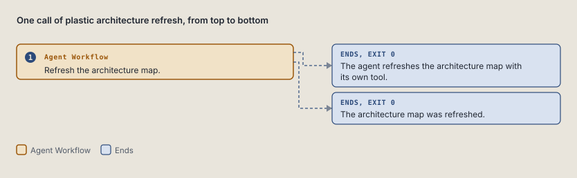

# plastic architecture refresh

Tell the agent to regenerate the architecture map with its own tool.

```sh
plastic architecture refresh
```

## The events of one call, step by step



The boxes on the left run in order. The boxes on the right are the ways the call stops or ends at that step.

## What one call changes

This command changes nothing.

## What the agent workflow steps print

| Step | The text the agent gets |
| --- | --- |
| 1 | Regenerate the project's architecture map with an architecture mapping tool such as Enola; the choice of tool is yours. Read the new map for context. When you deliver an intent, note the tool, the source revision the map describes, what it covers and what it leaves out as the Architecture map: line under Verification in outcome.md. |

The command is `Plastic::Commands::Architecture::Refresh`, in [`refresh.rb:9`](../../../../lib/plastic/commands/architecture/refresh.rb#L9).
