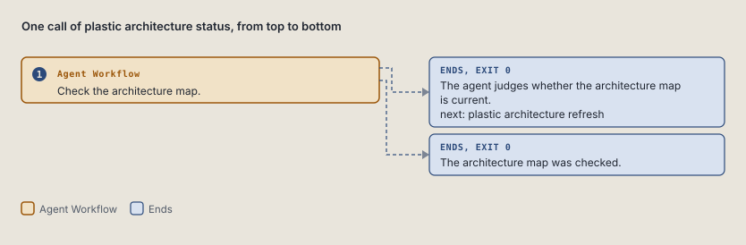

# plastic architecture status

Tell the agent to check the architecture map with its own tool.

```sh
plastic architecture status
```

## The events of one call, step by step



The boxes on the left run in order. The boxes on the right are the ways the call stops or ends at that step.

## What one call changes

This command changes nothing.

## What the agent workflow steps print

| Step | The text the agent gets |
| --- | --- |
| 1 | Check whether the project has an architecture map and whether it describes the source as it is now. Use an architecture mapping tool such as Enola; the choice of tool is yours. When the map is current, read it for context before you plan code work. When it is missing or older than the source, refresh it. |

The command is `Plastic::Commands::Architecture::Status`, in [`commands/architecture/status.rb`](../../../../lib/plastic/commands/architecture/status.rb).
