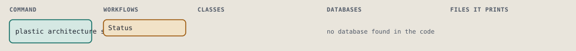
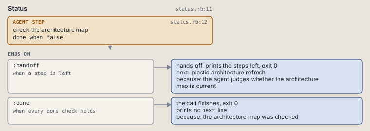
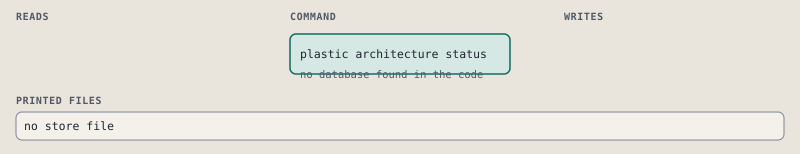

# plastic architecture status

Tell the agent to check the architecture map with its own tool.

```sh
plastic architecture status
```

The command is `Architecture::Status`, in [`status.rb:9`](../../../../lib/plastic/commands/architecture/status.rb#L9). The words on this page, such as gate, step and outcome, are explained in [the command DSL](../../dsl/README.md).

## Components



The figure shows the command, the workflows it runs, the classes behind them, and the databases and files they reach.

## The events of one call

The call starts the workflow `Agent::Architecture::Status`, in [`status.rb:11`](../../../../lib/plastic/workflows/agent/architecture/status.rb#L11).

The agent checks the architecture map with the tool it chose. Plastic runs no tool and reads no result, so the step is never done on its own.



Its rows run in this order:

1. Agent step: check the architecture map. Runs on every call; its done check is `false`. The call prints its `say:` text. [`status.rb:12`](../../../../lib/plastic/workflows/agent/architecture/status.rb#L12)
2. Outcome `:handoff`, when a step is left: hands off with exit 0; next: plastic architecture refresh. [`status.rb:17`](../../../../lib/plastic/workflows/agent/architecture/status.rb#L17)
3. Outcome `:done`, when every done check holds: finishes with exit 0; prints no next: line. [`status.rb:18`](../../../../lib/plastic/workflows/agent/architecture/status.rb#L18)

The agent step "check the architecture map" prints:

> Check whether the project has an architecture map and whether it describes the source as it is now. Use an architecture mapping tool such as Enola; the choice of tool is yours. When the map is current, read it for context. When it is missing or older than the source, refresh it.

While a step is left, the call hands off with exit 0 from `:handoff`: it prints the `say:` text of each failing step and offers next: plastic architecture refresh. The command writes nothing, so the call keeps no routine run row. The next call starts fresh and checks the steps again.

In the words of workflow engines, the rows are these four parts:

- **Trigger**: the call starts the workflow `Agent::Architecture::Status`.
- **Activities**: 1 agent step.
- **Transitions**: a step runs only while its done check fails.
- **Outcomes**: `:handoff`, `:done` end the call.

## What one call reads, writes and prints



It reads and writes no store database and prints no store file.

A second call runs the same rows again. A step runs again only when its done check fails.

| Step | Done when | The second call | Code |
| --- | --- | --- | --- |
| check the architecture map | `false` | runs it again | [`status.rb:12`](../../../../lib/plastic/workflows/agent/architecture/status.rb#L12) |

## How a call ends

Every call can also end in [the ways any call can end](../../dsl/README.md#how-any-call-can-end).

| Ending | Exit | next: | Code |
| --- | --- | --- | --- |
| the agent judges whether the architecture map is current | 0 | plastic architecture refresh | [`status.rb:17`](../../../../lib/plastic/workflows/agent/architecture/status.rb#L17) |
| the architecture map was checked | 0 | prints no next: line | [`status.rb:18`](../../../../lib/plastic/workflows/agent/architecture/status.rb#L18) |

## What the page leaves out

Every call shares a few things that this page does not repeat; [the command DSL](../../dsl/README.md#what-every-call-shares) names them.

- No gate of this command refuses, so exit 3 never happens.
