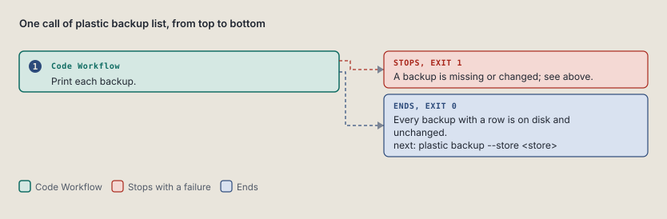

# plastic backup list

List one store's backups with status and goal, flagging a missing or changed file.

```sh
plastic backup list --store SLUG
```

| Argument or option | What it gives | Default |
| --- | --- | --- |
| `--store SLUG` | the registered project whose backups the call works on |  |

## The events of one call, step by step



The boxes on the left run in order. The boxes on the right are the ways the call stops or ends at that step.

## What one call changes

This command changes nothing.

The command is `Plastic::Commands::Backup::List`, in [`list.rb:11`](../../../../lib/plastic/commands/backup/list.rb#L11).
