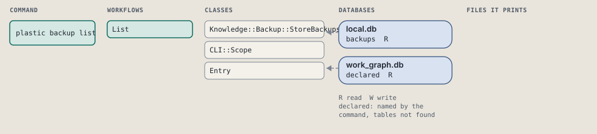
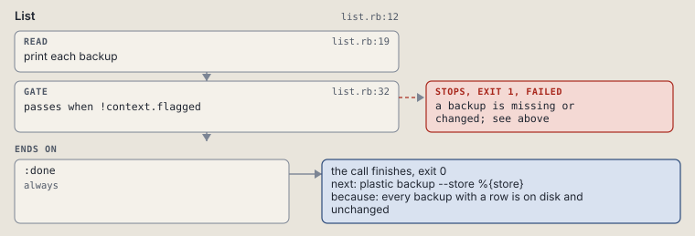
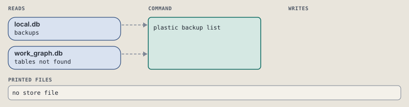

# plastic backup list

List one store's backups with status and goal, flagging a missing or changed file.

```sh
plastic backup list --store SLUG
```

The command is `Backup::List`, in [`list.rb:11`](../../../../lib/plastic/commands/backup/list.rb#L11). The words on this page, such as gate, step and outcome, are explained in [the command DSL](../../dsl/README.md).

| Argument or option | What it gives | Default |
| --- | --- | --- |
| `--store SLUG` | the registered project whose backups the call works on |  |

## Components



The figure shows the command, the workflows it runs, the classes behind them, and the databases and files they reach.

## The events of one call

### The command's own call

The command's own `call`, at [`backup_store.rb:15`](../../../../lib/plastic/commands/backup_store.rb#L15), runs first, then starts the workflow [Code::Backup::List](#codebackuplist).

```ruby
def call
  refuse_project
  refuse_unregistered
  check_call
  super
end
```

### Code::Backup::List

The code workflow `:code_backup_list`, in [`list.rb:12`](../../../../lib/plastic/workflows/code/backup/list.rb#L12).

Prints each backup folder of the store with its start time, status and goal, flagging a missing or changed file. A flag fails the call.



Its rows run in this order:

1. Read: print each backup. [`list.rb:19`](../../../../lib/plastic/workflows/code/backup/list.rb#L19)
2. Gate: passes when `!context.flagged`; otherwise the call stops with exit 1 and prints a backup is missing or changed; see above. [`list.rb:32`](../../../../lib/plastic/workflows/code/backup/list.rb#L32)
3. Outcome `:done`, always: finishes with exit 0; next: plastic backup --store STORE. [`list.rb:34`](../../../../lib/plastic/workflows/code/backup/list.rb#L34)

It sets `flagged`.

In the words of workflow engines, the rows are these four parts:

- **Trigger**: the call starts the workflow `Code::Backup::List`.
- **Activities**: 1 read.
- **Transitions**: 1 gate stops the call when its check fails.
- **Outcomes**: `:done` ends the call.

## What one call reads, writes and prints



| Place | Database or file | Tables | Reads or writes | Code |
| --- | --- | --- | --- | --- |
| the home folder | local.db | `backups` | reads | found in the code, not declared |
| the store folder | work_graph.db | not found in the code | reads | [`list.rb:14`](../../../../lib/plastic/commands/backup/list.rb#L14) |

## How a call ends

Every call can also end in [the ways any call can end](../../dsl/README.md#how-any-call-can-end).

| Ending | Exit | next: | Code |
| --- | --- | --- | --- |
| a backup is missing or changed; see above | 1 | prints no next: line | [`list.rb:32`](../../../../lib/plastic/workflows/code/backup/list.rb#L32) |
| every backup with a row is on disk and unchanged | 0 | plastic backup --store STORE | [`list.rb:34`](../../../../lib/plastic/workflows/code/backup/list.rb#L34) |
| a step raises | 1 | prints no next: line | [`code_workflow.rb:102`](../../../../lib/plastic/code_workflow.rb#L102) |
| Usage error: name the store with --store; --project does not apply | 2 | prints no next: line | [`backup_store.rb:27`](../../../../lib/plastic/commands/backup_store.rb#L27) |
| Usage error: no registered project named SLUG; the projects are PROJECTS | 2 | prints no next: line | [`backup_store.rb:35`](../../../../lib/plastic/commands/backup_store.rb#L35) |

## What the page leaves out

Every call shares a few things that this page does not repeat; [the command DSL](../../dsl/README.md#what-every-call-shares) names them.

- No gate of this command refuses, so exit 3 never happens.
