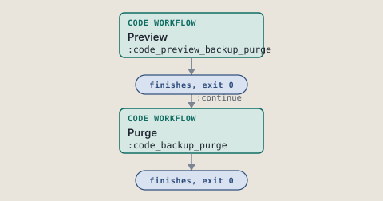
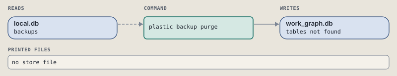

# plastic backup purge

Delete one store's backups; give one of --all, --failed or --older-than.

Deletes backups of one registered store: all of them, those before a date, or those that failed.

```sh
plastic backup purge --store SLUG (--older-than DATE | --all | --failed) [--dry-run]
```

The command is `Backup::Purge`, in [`purge.rb:12`](../../../../lib/plastic/commands/backup/purge.rb#L12). The words on this page, such as gate, step and outcome, are explained in [the command DSL](../../dsl/README.md).

| Argument or option | What it gives | Default |
| --- | --- | --- |
| `--store SLUG` | the registered project whose backups the call works on |  |
| `--older-than DATE` | delete the backups before this date or time |  |
| `--all` | delete every backup of the store | `false` |
| `--failed` | delete every backup whose status is failed | `false` |
| `--dry-run` | list what would be deleted and delete nothing | `false` |

## Components


The figure shows the command, the workflows it runs, the classes behind them, and the databases and files they reach.

## The events of one call



| Workflow | Kind | Code |
| --- | --- | --- |
| [Code::Backup::Purge::Preview](#codebackuppurgepreview) | code | [`preview.rb:12`](../../../../lib/plastic/workflows/code/backup/purge/preview.rb#L12) |
| [Code::Backup::Purge](#codebackuppurge) | code | [`purge.rb:13`](../../../../lib/plastic/workflows/code/backup/purge.rb#L13) |

### The command's own call

The command's own `call`, at [`backup_store.rb:15`](../../../../lib/plastic/commands/backup_store.rb#L15), runs first, then starts the workflow [Code::Backup::Purge::Preview](#codebackuppurgepreview).

```ruby
def call
  refuse_project
  refuse_unregistered
  check_call
  super
end
```

The command's own `check_call`, at [`purge.rb:32`](../../../../lib/plastic/commands/backup/purge.rb#L32), runs inside it:

```ruby
def check_call
  one_of(%i[older_than all failed], give: "give --older-than DATE, --all or --failed", both: "--older-than, --all and --failed exclude each other")
  read_date
end
```

### Code::Backup::Purge::Preview

The code workflow `:code_preview_backup_purge`, in [`preview.rb:12`](../../../../lib/plastic/workflows/code/backup/purge/preview.rb#L12).

Lists the backups a purge would delete, and deletes nothing.


Its rows run in this order:

1. Read: preview the purge. [`preview.rb:15`](../../../../lib/plastic/workflows/code/backup/purge/preview.rb#L15)
2. Outcome `:done`, when `context.dry_run`: finishes with exit 0; next: ORIGINAL_COMMAND. [`preview.rb:22`](../../../../lib/plastic/workflows/code/backup/purge/preview.rb#L22)
3. Outcome `:continue`, otherwise: starts the workflow [Code::Backup::Purge](#codebackuppurge). [`preview.rb:24`](../../../../lib/plastic/workflows/code/backup/purge/preview.rb#L24)

### Code::Backup::Purge

The code workflow `:code_backup_purge`, in [`purge.rb:13`](../../../../lib/plastic/workflows/code/backup/purge.rb#L13).

Deletes the backup folders of one store with their rows: all of them, or those strictly before a time, or those that failed. A row with no folder goes with them.


Its rows run in this order:

1. Step: delete the backups. Done when `!context.purged.nil?`, so a second call skips it. [`purge.rb:28`](../../../../lib/plastic/workflows/code/backup/purge.rb#L28)
2. Read: say what was deleted. [`purge.rb:35`](../../../../lib/plastic/workflows/code/backup/purge.rb#L35)
3. Outcome `:done`, always: finishes with exit 0; next: plastic backup list --store STORE. [`purge.rb:40`](../../../../lib/plastic/workflows/code/backup/purge.rb#L40)

It sets `purged`.

In the words of workflow engines, the rows are these four parts:

- **Trigger**: the call starts the workflow `Code::Backup::Purge::Preview`; each later workflow starts from an outcome of the one before it.
- **Activities**: 2 reads and 1 step.
- **Transitions**: a step runs only while its done check fails; Preview goes to Purge on `:continue`.
- **Outcomes**: `:done` of Preview, `:done` of Purge end the call.

## What one call reads, writes and prints



| Place | Database or file | Tables | Reads or writes | Code |
| --- | --- | --- | --- | --- |
| the home folder | local.db | `backups` | reads | found in the code, not declared |
| the store folder | work_graph.db | not found in the code | writes | [`purge.rb:15`](../../../../lib/plastic/commands/backup/purge.rb#L15) |

A second call runs the same rows again. A step runs again only when its done check fails.

| Step | Done when | The second call | Code |
| --- | --- | --- | --- |
| delete the backups | `!context.purged.nil?` | skips it | [`purge.rb:28`](../../../../lib/plastic/workflows/code/backup/purge.rb#L28) |

## How a call ends

Every call can also end in [the ways any call can end](../../dsl/README.md#how-any-call-can-end).

| Ending | Exit | next: | Code |
| --- | --- | --- | --- |
| the preview deleted nothing | 0 | ORIGINAL_COMMAND | [`preview.rb:22`](../../../../lib/plastic/workflows/code/backup/purge/preview.rb#L22) |
| the backups named above are gone | 0 | plastic backup list --store STORE | [`purge.rb:40`](../../../../lib/plastic/workflows/code/backup/purge.rb#L40) |
| a step raises | 1 | prints no next: line | [`code_workflow.rb:102`](../../../../lib/plastic/code_workflow.rb#L102) |
| Usage error: name the store with --store; --project does not apply | 2 | prints no next: line | [`backup_store.rb:27`](../../../../lib/plastic/commands/backup_store.rb#L27) |
| Usage error: no registered project named SLUG; the projects are PROJECTS | 2 | prints no next: line | [`backup_store.rb:35`](../../../../lib/plastic/commands/backup_store.rb#L35) |
| Usage error | 2 | prints no next: line | [`backup_store.rb:40`](../../../../lib/plastic/commands/backup_store.rb#L40) |
| Usage error | 2 | prints no next: line | [`backup_store.rb:41`](../../../../lib/plastic/commands/backup_store.rb#L41) |
| Usage error | 2 | prints no next: line | [`backup_store.rb:47`](../../../../lib/plastic/commands/backup_store.rb#L47) |

## What the page leaves out

Every call shares a few things that this page does not repeat; [the command DSL](../../dsl/README.md#what-every-call-shares) names them.

- A call that writes saves a routine run row in local.db. A stop by a gate or a step saves the run, and the next call resumes from it. A dry run saves no row.
