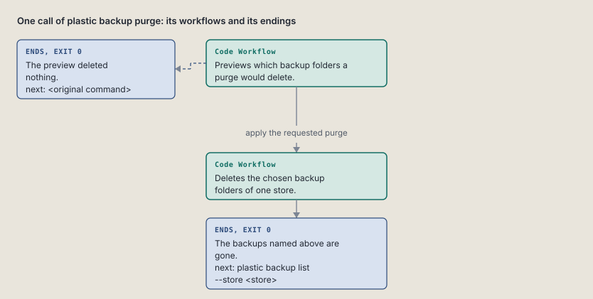
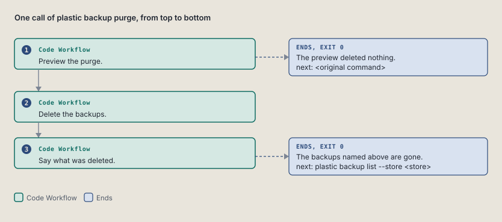

# plastic backup purge

Delete one store's backups; give one of --all, --failed or --older-than.

Deletes backups of one registered store: all of them, those before a date, or those that failed.

```sh
plastic backup purge --store SLUG (--older-than DATE | --all | --failed) [--dry-run]
```

| Argument or option | What it gives | Default |
| --- | --- | --- |
| `--store SLUG` | the registered project whose backups the call works on |  |
| `--older-than DATE` | delete the backups before this date or time |  |
| `--all` | delete every backup of the store | `false` |
| `--failed` | delete every backup whose status is failed | `false` |
| `--dry-run` | list what would be deleted and delete nothing | `false` |

## The workflows of one call



Each box is a workflow. The words between the boxes say when the call moves on, and the last boxes say how the call ends.

## The events of one call, step by step



The boxes on the left run in order. The boxes on the right are the ways the call stops or ends at that step.

## What one call changes

| What changes | Where | Reach |
| --- | --- | --- |
| The chosen backup folders are deleted | the backups folder, in the store folder | goes with the store |

Goes with the store: the files of the store carry the change, and `plastic sync up` rebuilds it on another machine. The database files themselves stay on this machine.

The command is `Plastic::Commands::Backup::Purge`, in [`purge.rb:12`](../../../../lib/plastic/commands/backup/purge.rb#L12).
