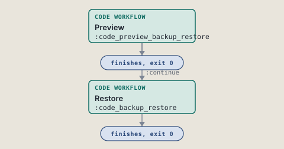

# plastic backup restore

Replace one store's databases with those of a done backup.

```sh
plastic backup restore --store SLUG [--timestamp TS] [--latest] [--databases LIST] [--dry-run]
```

The command is `Backup::Restore`, in [`restore.rb:12`](../../../../lib/plastic/commands/backup/restore.rb#L12). The words on this page, such as gate, step and outcome, are explained in [the command DSL](../../dsl/README.md).

| Argument or option | What it gives | Default |
| --- | --- | --- |
| `--store SLUG` | the registered project whose backups the call works on |  |
| `--timestamp TS` | the backup to restore, by its folder name |  |
| `--latest` | restore the newest backup that is done | `false` |
| `--databases LIST` | the databases to restore, comma separated; all the backup holds when left out |  |
| `--dry-run` | list what would be replaced and change nothing | `false` |

## What it touches


## Before the chain

The command's own `call`, at [`backup_store.rb:15`](../../../../lib/plastic/commands/backup_store.rb#L15), runs first:

```ruby
def call
  refuse_project
  refuse_unregistered
  check_call
  super
end
```

The command's own `check_call`, at [`restore.rb:30`](../../../../lib/plastic/commands/backup/restore.rb#L30), runs inside it:

```ruby
def check_call
  one_of(%i[timestamp latest], give: "give --timestamp TS or --latest", both: "--latest and --timestamp exclude each other")
  database_list
end
```

## How the call flows



| Workflow | Kind | Code |
| --- | --- | --- |
| [Code::Backup::Restore::Preview](#codebackuprestorepreview) | code | [`preview.rb:12`](../../../../lib/plastic/workflows/code/backup/restore/preview.rb#L12) |
| [Code::Backup::Restore](#codebackuprestore) | code | [`restore.rb:14`](../../../../lib/plastic/workflows/code/backup/restore.rb#L14) |

### Code::Backup::Restore::Preview

The code workflow `:code_preview_backup_restore`, in [`preview.rb:12`](../../../../lib/plastic/workflows/code/backup/restore/preview.rb#L12).

Lists the databases a restore would replace, and changes nothing.


| Step | Kind | Check | Code |
| --- | --- | --- | --- |
| preview the restore | read |  | [`preview.rb:15`](../../../../lib/plastic/workflows/code/backup/restore/preview.rb#L15) |

| Outcome | When | Then | Code |
| --- | --- | --- | --- |
| `:done` | when `context.dry_run` | finishes, exit 0; next: %{original_command} | [`preview.rb:23`](../../../../lib/plastic/workflows/code/backup/restore/preview.rb#L23) |
| `:continue` | otherwise | runs [Code::Backup::Restore](#codebackuprestore) | [`preview.rb:25`](../../../../lib/plastic/workflows/code/backup/restore/preview.rb#L25) |

### Code::Backup::Restore

The code workflow `:code_backup_restore`, in [`restore.rb:14`](../../../../lib/plastic/workflows/code/backup/restore.rb#L14).

Replaces the databases of one store with those of a done backup, after a safety backup of the current ones.


| Step | Kind | Check | Code |
| --- | --- | --- | --- |
| choose the backup | read |  | [`restore.rb:41`](../../../../lib/plastic/workflows/code/backup/restore.rb#L41) |
| %{refusal} | gate, stops with exit 3 | `context.refusal.nil?` | [`restore.rb:47`](../../../../lib/plastic/workflows/code/backup/restore.rb#L47) |
| replace the databases | step | `!context.safety.nil?` | [`restore.rb:49`](../../../../lib/plastic/workflows/code/backup/restore.rb#L49) |
| say what was replaced | read |  | [`restore.rb:55`](../../../../lib/plastic/workflows/code/backup/restore.rb#L55) |

| Outcome | When | Then | Code |
| --- | --- | --- | --- |
| `:done` | always | finishes, exit 0; next: plastic sync down --project %{store} | [`restore.rb:60`](../../../../lib/plastic/workflows/code/backup/restore.rb#L60) |

It sets `folder`, `refusal`, `safety`, `restored`.

## Outcomes

Every call can also end in [the ways any call can end](../../dsl/README.md#how-any-call-can-end).

| Ending | Exit | next: | Code |
| --- | --- | --- | --- |
| the preview replaced nothing | 0 | %{original_command} | [`preview.rb:23`](../../../../lib/plastic/workflows/code/backup/restore/preview.rb#L23) |
| %{refusal} | 3 | prints no next: line | [`restore.rb:47`](../../../../lib/plastic/workflows/code/backup/restore.rb#L47) |
| the rows are restored and the files are not; sync down writes the files from the rows | 0 | plastic sync down --project %{store} | [`restore.rb:60`](../../../../lib/plastic/workflows/code/backup/restore.rb#L60) |
| a step raises | 1 | prints no next: line | [`code_workflow.rb:102`](../../../../lib/plastic/code_workflow.rb#L102) |
| Usage error: name the store with --store; --project does not apply | 2 | prints no next: line | [`backup_store.rb:27`](../../../../lib/plastic/commands/backup_store.rb#L27) |
| Usage error: no registered project named %{slug}; the projects are %{projects} | 2 | prints no next: line | [`backup_store.rb:35`](../../../../lib/plastic/commands/backup_store.rb#L35) |
| Usage error | 2 | prints no next: line | [`backup_store.rb:40`](../../../../lib/plastic/commands/backup_store.rb#L40) |
| Usage error | 2 | prints no next: line | [`backup_store.rb:41`](../../../../lib/plastic/commands/backup_store.rb#L41) |
| Usage error | 2 | prints no next: line | [`backup_store.rb:47`](../../../../lib/plastic/commands/backup_store.rb#L47) |
