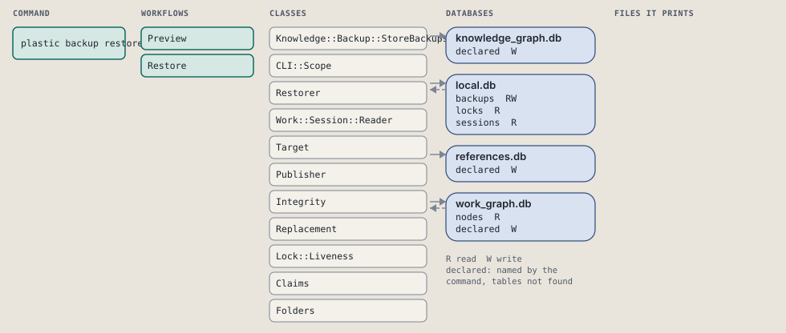
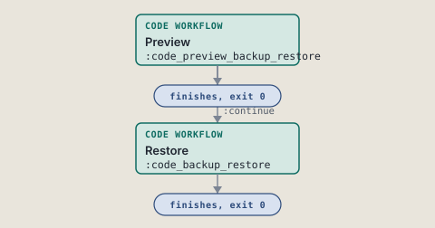
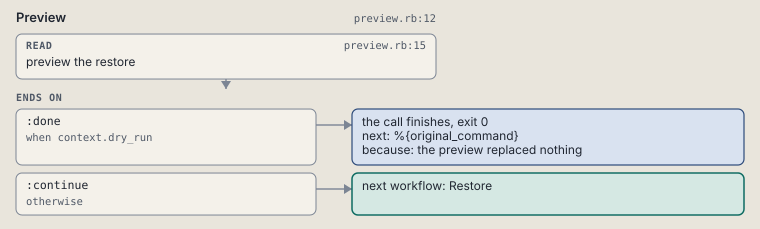
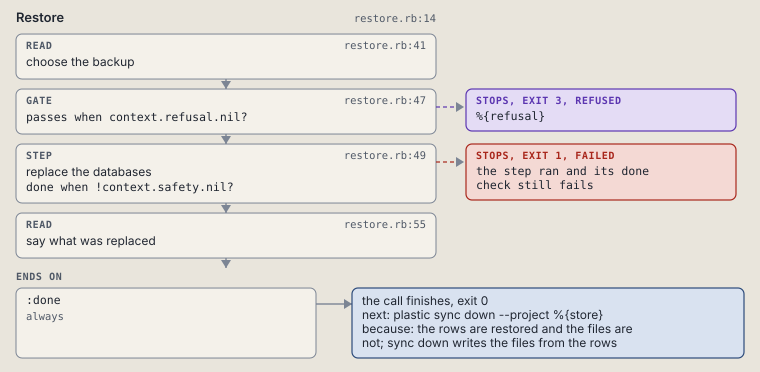
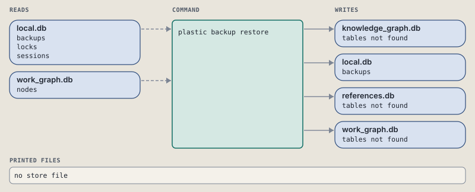

# plastic backup restore

Replace one store's databases with those of a done backup.

```sh
plastic backup restore --store SLUG [--timestamp TS] [--latest] [--databases LIST] [--dry-run]
```

The command is `Backup::Restore`, in [`restore.rb:12`](../../../../lib/plastic/commands/backup/restore.rb#L12). The words on this page, such as gate, step and outcome, are explained in [the command DSL](../../dsl/README.md).

| Argument or option | What it gives | Default |
| --- | --- | --- |
| `--store SLUG` | the registered project whose backups the call works on |  |
| `--timestamp TS` | the backup to restore, by its folder name |  |
| `--latest` | restore the newest backup that is done | `false` |
| `--databases LIST` | the databases to restore, comma separated; all the backup holds when left out |  |
| `--dry-run` | list what would be replaced and change nothing | `false` |

## Components



The figure shows the command, the workflows it runs, the classes behind them, and the databases and files they reach.

## The events of one call



| Workflow | Kind | Code |
| --- | --- | --- |
| [Code::Backup::Restore::Preview](#codebackuprestorepreview) | code | [`preview.rb:12`](../../../../lib/plastic/workflows/code/backup/restore/preview.rb#L12) |
| [Code::Backup::Restore](#codebackuprestore) | code | [`restore.rb:14`](../../../../lib/plastic/workflows/code/backup/restore.rb#L14) |

### The command's own call

The command's own `call`, at [`backup_store.rb:15`](../../../../lib/plastic/commands/backup_store.rb#L15), runs first, then starts the workflow [Code::Backup::Restore::Preview](#codebackuprestorepreview).

```ruby
def call
  refuse_project
  refuse_unregistered
  check_call
  super
end
```

The command's own `check_call`, at [`restore.rb:30`](../../../../lib/plastic/commands/backup/restore.rb#L30), runs inside it:

```ruby
def check_call
  one_of(%i[timestamp latest], give: "give --timestamp TS or --latest", both: "--latest and --timestamp exclude each other")
  database_list
end
```

### Code::Backup::Restore::Preview

The code workflow `:code_preview_backup_restore`, in [`preview.rb:12`](../../../../lib/plastic/workflows/code/backup/restore/preview.rb#L12).

Lists the databases a restore would replace, and changes nothing.



Its rows run in this order:

1. Read: preview the restore. [`preview.rb:15`](../../../../lib/plastic/workflows/code/backup/restore/preview.rb#L15)
2. Outcome `:done`, when `context.dry_run`: finishes with exit 0; next: ORIGINAL_COMMAND. [`preview.rb:23`](../../../../lib/plastic/workflows/code/backup/restore/preview.rb#L23)
3. Outcome `:continue`, otherwise: starts the workflow [Code::Backup::Restore](#codebackuprestore). [`preview.rb:25`](../../../../lib/plastic/workflows/code/backup/restore/preview.rb#L25)

### Code::Backup::Restore

The code workflow `:code_backup_restore`, in [`restore.rb:14`](../../../../lib/plastic/workflows/code/backup/restore.rb#L14).

Replaces the databases of one store with those of a done backup, after a safety backup of the current ones.



Its rows run in this order:

1. Read: choose the backup. [`restore.rb:41`](../../../../lib/plastic/workflows/code/backup/restore.rb#L41)
2. Gate: passes when `context.refusal.nil?`; otherwise the call stops with exit 3 and prints REFUSAL. [`restore.rb:47`](../../../../lib/plastic/workflows/code/backup/restore.rb#L47)
3. Step: replace the databases. Done when `!context.safety.nil?`, so a second call skips it. [`restore.rb:49`](../../../../lib/plastic/workflows/code/backup/restore.rb#L49)
4. Read: say what was replaced. [`restore.rb:55`](../../../../lib/plastic/workflows/code/backup/restore.rb#L55)
5. Outcome `:done`, always: finishes with exit 0; next: plastic sync down --project STORE. [`restore.rb:60`](../../../../lib/plastic/workflows/code/backup/restore.rb#L60)

It sets `folder`, `refusal`, `safety`, `restored`.

In the words of workflow engines, the rows are these four parts:

- **Trigger**: the call starts the workflow `Code::Backup::Restore::Preview`; each later workflow starts from an outcome of the one before it.
- **Activities**: 3 reads and 1 step.
- **Transitions**: 1 gate stops the call when its check fails; a step runs only while its done check fails; Preview goes to Restore on `:continue`.
- **Outcomes**: `:done` of Preview, `:done` of Restore end the call.

## What one call reads, writes and prints



| Place | Database or file | Tables | Reads or writes | Code |
| --- | --- | --- | --- | --- |
| the store folder | knowledge_graph.db | not found in the code | writes | [`restore.rb:15`](../../../../lib/plastic/commands/backup/restore.rb#L15) |
| the home folder | local.db | `backups`, `locks`, `sessions` | reads and writes | found in the code, not declared |
| the store folder | references.db | not found in the code | writes | [`restore.rb:15`](../../../../lib/plastic/commands/backup/restore.rb#L15) |
| the store folder | work_graph.db | `nodes` | reads and writes | [`restore.rb:15`](../../../../lib/plastic/commands/backup/restore.rb#L15) |

A second call runs the same rows again. A step runs again only when its done check fails.

| Step | Done when | The second call | Code |
| --- | --- | --- | --- |
| replace the databases | `!context.safety.nil?` | skips it | [`restore.rb:49`](../../../../lib/plastic/workflows/code/backup/restore.rb#L49) |

## How a call ends

Every call can also end in [the ways any call can end](../../dsl/README.md#how-any-call-can-end).

| Ending | Exit | next: | Code |
| --- | --- | --- | --- |
| the preview replaced nothing | 0 | ORIGINAL_COMMAND | [`preview.rb:23`](../../../../lib/plastic/workflows/code/backup/restore/preview.rb#L23) |
| REFUSAL | 3 | prints no next: line | [`restore.rb:47`](../../../../lib/plastic/workflows/code/backup/restore.rb#L47) |
| the rows are restored and the files are not; sync down writes the files from the rows | 0 | plastic sync down --project STORE | [`restore.rb:60`](../../../../lib/plastic/workflows/code/backup/restore.rb#L60) |
| a step raises | 1 | prints no next: line | [`code_workflow.rb:102`](../../../../lib/plastic/code_workflow.rb#L102) |
| Usage error: name the store with --store; --project does not apply | 2 | prints no next: line | [`backup_store.rb:27`](../../../../lib/plastic/commands/backup_store.rb#L27) |
| Usage error: no registered project named SLUG; the projects are PROJECTS | 2 | prints no next: line | [`backup_store.rb:35`](../../../../lib/plastic/commands/backup_store.rb#L35) |
| Usage error | 2 | prints no next: line | [`backup_store.rb:40`](../../../../lib/plastic/commands/backup_store.rb#L40) |
| Usage error | 2 | prints no next: line | [`backup_store.rb:41`](../../../../lib/plastic/commands/backup_store.rb#L41) |
| Usage error | 2 | prints no next: line | [`backup_store.rb:47`](../../../../lib/plastic/commands/backup_store.rb#L47) |

## What the page leaves out

Every call shares a few things that this page does not repeat; [the command DSL](../../dsl/README.md#what-every-call-shares) names them.

- A call that writes saves a routine run row in local.db. A stop by a gate or a step saves the run, and the next call resumes from it. A dry run saves no row.
