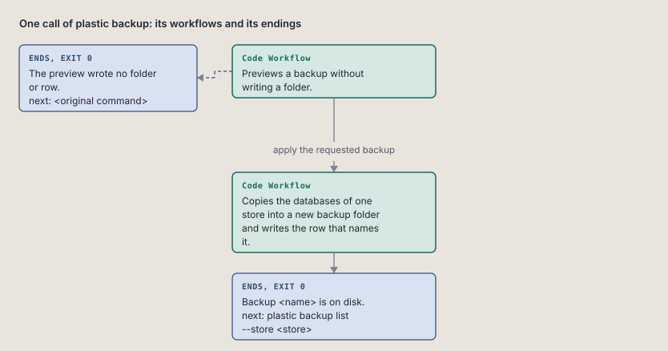
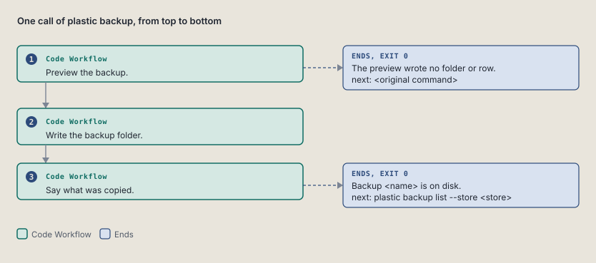

# plastic backup

Copy one store's databases into a new backup folder.

```sh
plastic backup --store SLUG [--databases LIST] [--live] [--dry-run]
```

| Argument or option | What it gives | Default |
| --- | --- | --- |
| `--store SLUG` | the registered project whose backups the call works on |  |
| `--databases LIST` | the databases to copy, comma separated; all of them when left out |  |
| `--live` | print each line of the backup log as it is written | `false` |
| `--dry-run` | preview the backup without writing a folder | `false` |

## The workflows of one call



Each box is a workflow. The words between the boxes say when the call moves on, and the last boxes say how the call ends.

## The events of one call, step by step



The boxes on the left run in order. The boxes on the right are the ways the call stops or ends at that step.

## What one call changes

| What changes | Where | Reach |
| --- | --- | --- |
| A backup folder with a copy of each chosen database is written | the backups folder, in the store folder | stays on this machine |
| The run of the call is kept for a resume | the work graph database, in the store folder | stays on this machine |

The command is `Plastic::Commands::Backup`, in [`backup.rb:10`](../../../../lib/plastic/commands/backup.rb#L10).
