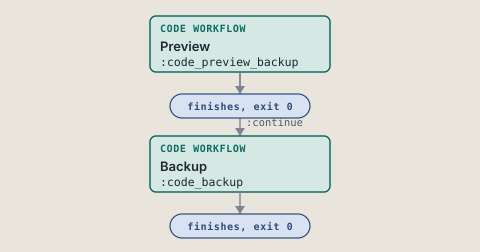
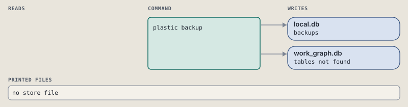

# plastic backup

Copy one store's databases into a new backup folder.

```sh
plastic backup --store SLUG [--databases LIST] [--live] [--dry-run]
```

The command is `Backup`, in [`backup.rb:10`](../../../../lib/plastic/commands/backup.rb#L10). The words on this page, such as gate, step and outcome, are explained in [the command DSL](../../dsl/README.md).

| Argument or option | What it gives | Default |
| --- | --- | --- |
| `--store SLUG` | the registered project whose backups the call works on |  |
| `--databases LIST` | the databases to copy, comma separated; all of them when left out |  |
| `--live` | print each line of the backup log as it is written | `false` |
| `--dry-run` | preview the backup without writing a folder | `false` |

## Components


The figure shows the command, the workflows it runs, the classes behind them, and the databases and files they reach.

## The events of one call



| Workflow | Kind | Code |
| --- | --- | --- |
| [Code::Backup::Preview](#codebackuppreview) | code | [`preview.rb:12`](../../../../lib/plastic/workflows/code/backup/preview.rb#L12) |
| [Code::Backup](#codebackup) | code | [`backup.rb:11`](../../../../lib/plastic/workflows/code/backup.rb#L11) |

### The command's own call

The command's own `call`, at [`backup_store.rb:15`](../../../../lib/plastic/commands/backup_store.rb#L15), runs first, then starts the workflow [Code::Backup::Preview](#codebackuppreview).

```ruby
def call
  refuse_project
  refuse_unregistered
  check_call
  super
end
```

The command's own `check_call`, at [`backup.rb:27`](../../../../lib/plastic/commands/backup.rb#L27), runs inside it:

```ruby
def check_call = database_list
```

### Code::Backup::Preview

The code workflow `:code_preview_backup`, in [`preview.rb:12`](../../../../lib/plastic/workflows/code/backup/preview.rb#L12).

Says which folder and databases a backup would write, and writes nothing.


Its rows run in this order:

1. Read: preview the backup. [`preview.rb:15`](../../../../lib/plastic/workflows/code/backup/preview.rb#L15)
2. Outcome `:done`, when `context.dry_run`: finishes with exit 0; next: ORIGINAL_COMMAND. [`preview.rb:22`](../../../../lib/plastic/workflows/code/backup/preview.rb#L22)
3. Outcome `:continue`, otherwise: starts the workflow [Code::Backup](#codebackup). [`preview.rb:24`](../../../../lib/plastic/workflows/code/backup/preview.rb#L24)

### Code::Backup

The code workflow `:code_backup`, in [`backup.rb:11`](../../../../lib/plastic/workflows/code/backup.rb#L11).

Copies the databases of one store into a new backup folder, and writes the row that names it.


Its rows run in this order:

1. Step: write the backup folder. Done when `!context.name.nil?`, so a second call skips it. [`backup.rb:16`](../../../../lib/plastic/workflows/code/backup.rb#L16)
2. Read: say what was copied. [`backup.rb:23`](../../../../lib/plastic/workflows/code/backup.rb#L23)
3. Outcome `:done`, always: finishes with exit 0; next: plastic backup list --store STORE. [`backup.rb:28`](../../../../lib/plastic/workflows/code/backup.rb#L28)

It sets `name`, `files`, `bytes`.

In the words of workflow engines, the rows are these four parts:

- **Trigger**: the call starts the workflow `Code::Backup::Preview`; each later workflow starts from an outcome of the one before it.
- **Activities**: 2 reads and 1 step.
- **Transitions**: a step runs only while its done check fails; Preview goes to Backup on `:continue`.
- **Outcomes**: `:done` of Preview, `:done` of Backup end the call.

## What one call reads, writes and prints



| Place | Database or file | Tables | Reads or writes | Code |
| --- | --- | --- | --- | --- |
| the home folder | local.db | `backups` | writes | found in the code, not declared |
| the store folder | work_graph.db | not found in the code | writes | [`backup.rb:13`](../../../../lib/plastic/commands/backup.rb#L13) |

A second call runs the same rows again. A step runs again only when its done check fails.

| Step | Done when | The second call | Code |
| --- | --- | --- | --- |
| write the backup folder | `!context.name.nil?` | skips it | [`backup.rb:16`](../../../../lib/plastic/workflows/code/backup.rb#L16) |

## How a call ends

Every call can also end in [the ways any call can end](../../dsl/README.md#how-any-call-can-end).

| Ending | Exit | next: | Code |
| --- | --- | --- | --- |
| the preview wrote no folder or row | 0 | ORIGINAL_COMMAND | [`preview.rb:22`](../../../../lib/plastic/workflows/code/backup/preview.rb#L22) |
| backup NAME is on disk | 0 | plastic backup list --store STORE | [`backup.rb:28`](../../../../lib/plastic/workflows/code/backup.rb#L28) |
| a step raises | 1 | prints no next: line | [`code_workflow.rb:102`](../../../../lib/plastic/code_workflow.rb#L102) |
| Usage error: name the store with --store; --project does not apply | 2 | prints no next: line | [`backup_store.rb:27`](../../../../lib/plastic/commands/backup_store.rb#L27) |
| Usage error: no registered project named SLUG; the projects are PROJECTS | 2 | prints no next: line | [`backup_store.rb:35`](../../../../lib/plastic/commands/backup_store.rb#L35) |
| Usage error | 2 | prints no next: line | [`backup_store.rb:47`](../../../../lib/plastic/commands/backup_store.rb#L47) |

## What the page leaves out

Every call shares a few things that this page does not repeat; [the command DSL](../../dsl/README.md#what-every-call-shares) names them.

- A call that writes saves a routine run row in local.db. A stop by a gate or a step saves the run, and the next call resumes from it. A dry run saves no row.
