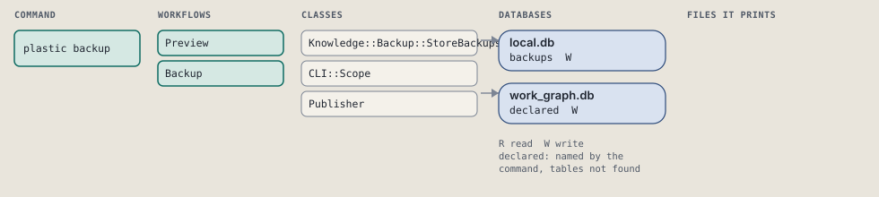
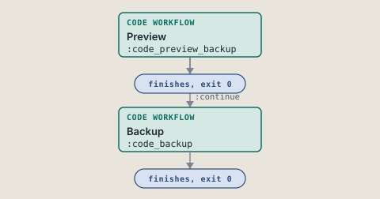
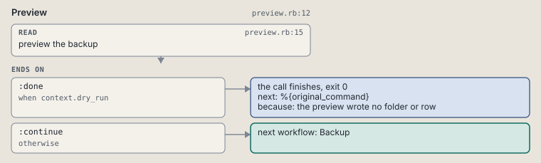
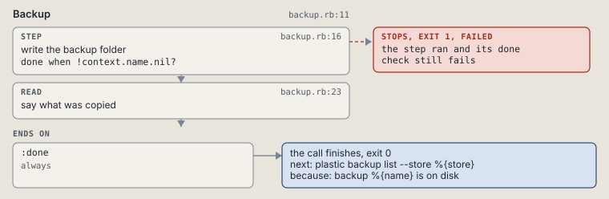

# plastic backup

Copy one store's databases into a new backup folder.

```sh
plastic backup --store SLUG [--databases LIST] [--live] [--dry-run]
```

The command is `Backup`, in [`backup.rb:10`](../../../../lib/plastic/commands/backup.rb#L10). The words on this page, such as gate, step and outcome, are explained in [the command DSL](../../dsl/README.md).

| Argument or option | What it gives | Default |
| --- | --- | --- |
| `--store SLUG` | the registered project whose backups the call works on |  |
| `--databases LIST` | the databases to copy, comma separated; all of them when left out |  |
| `--live` | print each line of the backup log as it is written | `false` |
| `--dry-run` | preview the backup without writing a folder | `false` |

## What it touches



## Before the chain

The command's own `call`, at [`backup_store.rb:15`](../../../../lib/plastic/commands/backup_store.rb#L15), runs first:

```ruby
def call
  refuse_project
  refuse_unregistered
  check_call
  super
end
```

The command's own `check_call`, at [`backup.rb:27`](../../../../lib/plastic/commands/backup.rb#L27), runs inside it:

```ruby
def check_call = database_list
```

## How the call flows



| Workflow | Kind | Code |
| --- | --- | --- |
| [Code::Backup::Preview](#codebackuppreview) | code | [`preview.rb:12`](../../../../lib/plastic/workflows/code/backup/preview.rb#L12) |
| [Code::Backup](#codebackup) | code | [`backup.rb:11`](../../../../lib/plastic/workflows/code/backup.rb#L11) |

### Code::Backup::Preview

The code workflow `:code_preview_backup`, in [`preview.rb:12`](../../../../lib/plastic/workflows/code/backup/preview.rb#L12).

Says which folder and databases a backup would write, and writes nothing.



| Step | Kind | Check | Code |
| --- | --- | --- | --- |
| preview the backup | read |  | [`preview.rb:15`](../../../../lib/plastic/workflows/code/backup/preview.rb#L15) |

| Outcome | When | Then | Code |
| --- | --- | --- | --- |
| `:done` | when `context.dry_run` | finishes, exit 0; next: %{original_command} | [`preview.rb:22`](../../../../lib/plastic/workflows/code/backup/preview.rb#L22) |
| `:continue` | otherwise | runs [Code::Backup](#codebackup) | [`preview.rb:24`](../../../../lib/plastic/workflows/code/backup/preview.rb#L24) |

### Code::Backup

The code workflow `:code_backup`, in [`backup.rb:11`](../../../../lib/plastic/workflows/code/backup.rb#L11).

Copies the databases of one store into a new backup folder, and writes the row that names it.



| Step | Kind | Check | Code |
| --- | --- | --- | --- |
| write the backup folder | step | `!context.name.nil?` | [`backup.rb:16`](../../../../lib/plastic/workflows/code/backup.rb#L16) |
| say what was copied | read |  | [`backup.rb:23`](../../../../lib/plastic/workflows/code/backup.rb#L23) |

| Outcome | When | Then | Code |
| --- | --- | --- | --- |
| `:done` | always | finishes, exit 0; next: plastic backup list --store %{store} | [`backup.rb:28`](../../../../lib/plastic/workflows/code/backup.rb#L28) |

It sets `name`, `files`, `bytes`.

## Outcomes

Every call can also end in [the ways any call can end](../../dsl/README.md#how-any-call-can-end).

| Ending | Exit | next: | Code |
| --- | --- | --- | --- |
| the preview wrote no folder or row | 0 | %{original_command} | [`preview.rb:22`](../../../../lib/plastic/workflows/code/backup/preview.rb#L22) |
| backup %{name} is on disk | 0 | plastic backup list --store %{store} | [`backup.rb:28`](../../../../lib/plastic/workflows/code/backup.rb#L28) |
| a step raises | 1 | prints no next: line | [`code_workflow.rb:102`](../../../../lib/plastic/code_workflow.rb#L102) |
| Usage error: name the store with --store; --project does not apply | 2 | prints no next: line | [`backup_store.rb:27`](../../../../lib/plastic/commands/backup_store.rb#L27) |
| Usage error: no registered project named %{slug}; the projects are %{projects} | 2 | prints no next: line | [`backup_store.rb:35`](../../../../lib/plastic/commands/backup_store.rb#L35) |
| Usage error | 2 | prints no next: line | [`backup_store.rb:47`](../../../../lib/plastic/commands/backup_store.rb#L47) |
