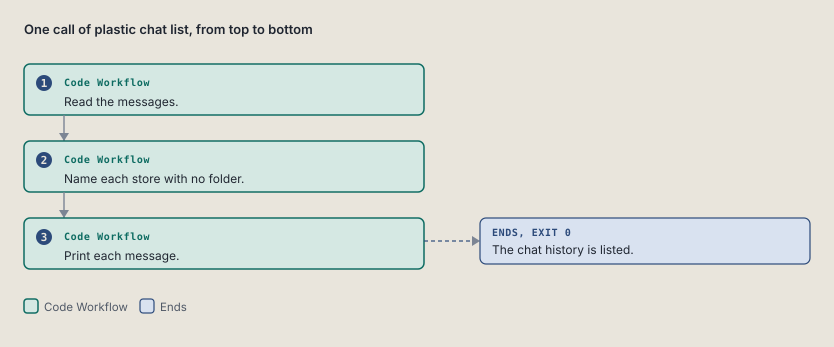

# plastic chat list

List the recorded chat messages of every store in time order, from a day on with --since.

```sh
plastic chat list [--since DATE]
```

| Argument or option | What it gives | Default |
| --- | --- | --- |
| `--since DATE` | list the messages from this day on, as YYYY-MM-DD in the clock's zone; all of them when left out |  |

## The events of one call, step by step



The boxes on the left run in order. The boxes on the right are the ways the call stops or ends at that step.

## What one call changes

This command changes nothing.

The command is `Plastic::Commands::Chat::List`, in [`commands/chat/list.rb`](../../../../lib/plastic/commands/chat/list.rb).
