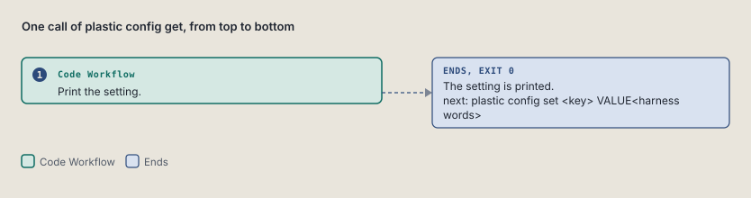

# plastic config get

Print the value of one setting.

```sh
plastic config get KEY [--harness NAME]
```

| Argument or option | What it gives | Default |
| --- | --- | --- |
| `KEY` | the setting, as its dotted name | |
| `--harness NAME` | the harness whose settings to use; the global settings when left out |  |

## The events of one call, step by step



The boxes on the left run in order. The boxes on the right are the ways the call stops or ends at that step.

## What one call changes

This command changes nothing.

The command is `Plastic::Commands::Config::Get`, in [`get.rb:11`](../../../../lib/plastic/commands/config/get.rb#L11).
