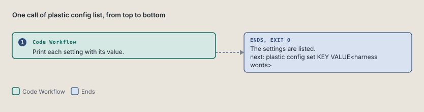

# plastic config list

List every setting with its value, globally or for one harness.

```sh
plastic config list [--harness NAME]
```

| Argument or option | What it gives | Default |
| --- | --- | --- |
| `--harness NAME` | the harness whose settings to use; the global settings when left out |  |

## The events of one call, step by step



The boxes on the left run in order. The boxes on the right are the ways the call stops or ends at that step.

## What one call changes

This command changes nothing.

The command is `Plastic::Commands::Config::List`, in [`list.rb:12`](../../../../lib/plastic/commands/config/list.rb#L12).
