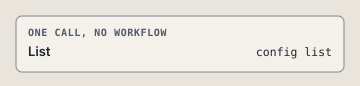
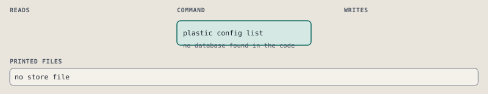

# plastic config list

List every setting with its value, globally or for one harness.

```sh
plastic config list [--harness NAME]
```

The command is `Config::List`, in [`list.rb:12`](../../../../lib/plastic/commands/config/list.rb#L12). The words on this page, such as gate, step and outcome, are explained in [the command DSL](../../dsl/README.md).

| Argument or option | What it gives | Default |
| --- | --- | --- |
| `--harness NAME` | the harness whose settings to use; the global settings when left out |  |

## Components


The figure shows the command, the workflows it runs, the classes behind them, and the databases and files they reach.

## The events of one call



The command's `call`, at [`list.rb:15`](../../../../lib/plastic/commands/config/list.rb#L15):

```ruby
def call
  config.entries.each { |key, value| output.row(key, value.to_s) }
  output.next_step("plastic config set KEY VALUE#{harness_words}", because: "the settings are listed")
end
```

Its steps run in this order:

1. `config.entries.each { |key, value| output.row(key, value.to_s) }` [`list.rb:16`](../../../../lib/plastic/commands/config/list.rb#L16)
2. `output.next_step("plastic config set KEY VALUE#{harness_words}", because: "the settings are listed")` [`list.rb:17`](../../../../lib/plastic/commands/config/list.rb#L17)

## What one call reads, writes and prints



It reads and writes no store database and prints no store file.

## How a call ends

Every call can also end in [the ways any call can end](../../dsl/README.md#how-any-call-can-end).

| Ending | Exit | next: | Code |
| --- | --- | --- | --- |
| Offers the next command | 0 | plastic config set KEY VALUE [HARNESS_WORDS] | [`list.rb:17`](../../../../lib/plastic/commands/config/list.rb#L17) |

## What the page leaves out

Every call shares a few things that this page does not repeat; [the command DSL](../../dsl/README.md#what-every-call-shares) names them.

- No gate of this command refuses, so exit 3 never happens.
