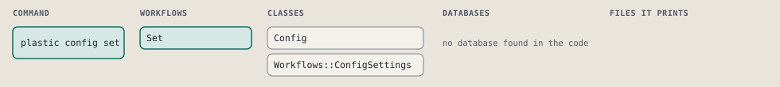
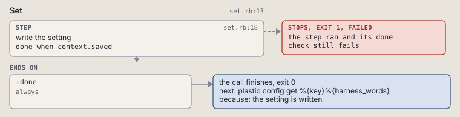
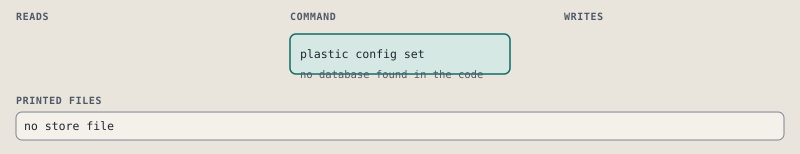

# plastic config set

Write one setting to config.yml, globally or for one harness.

```sh
plastic config set KEY VALUE [--harness NAME]
```

The command is `Config::Set`, in [`set.rb:12`](../../../../lib/plastic/commands/config/set.rb#L12). The words on this page, such as gate, step and outcome, are explained in [the command DSL](../../dsl/README.md).

| Argument or option | What it gives | Default |
| --- | --- | --- |
| `KEY` | the setting, as its dotted name | |
| `VALUE` | the new value | |
| `--harness NAME` | the harness whose settings to use; the global settings when left out |  |

## Components



The figure shows the command, the workflows it runs, the classes behind them, and the databases and files they reach.

## The events of one call

The call starts the workflow `Code::Config::Set`, in [`set.rb:13`](../../../../lib/plastic/workflows/code/config/set.rb#L13).

Writes one setting to config.yml: under `global`, or under the harness's section with --harness.



Its rows run in this order:

1. Step: write the setting. Done when `context.saved`, so a second call skips it. [`set.rb:18`](../../../../lib/plastic/workflows/code/config/set.rb#L18)
2. Outcome `:done`, always: finishes with exit 0; next: plastic config get KEYHARNESS_WORDS. [`set.rb:27`](../../../../lib/plastic/workflows/code/config/set.rb#L27)

It sets `harness_words`, `saved`.

In the words of workflow engines, the rows are these four parts:

- **Trigger**: the call starts the workflow `Code::Config::Set`.
- **Activities**: 1 step.
- **Transitions**: a step runs only while its done check fails.
- **Outcomes**: `:done` ends the call.

## What one call reads, writes and prints



It reads and writes no store database and prints no store file.

A second call runs the same rows again. A step runs again only when its done check fails.

| Step | Done when | The second call | Code |
| --- | --- | --- | --- |
| write the setting | `context.saved` | skips it | [`set.rb:18`](../../../../lib/plastic/workflows/code/config/set.rb#L18) |

## How a call ends

Every call can also end in [the ways any call can end](../../dsl/README.md#how-any-call-can-end).

| Ending | Exit | next: | Code |
| --- | --- | --- | --- |
| the setting is written | 0 | plastic config get KEYHARNESS_WORDS | [`set.rb:27`](../../../../lib/plastic/workflows/code/config/set.rb#L27) |
| a step raises | 1 | prints no next: line | [`code_workflow.rb:107`](../../../../lib/plastic/code_workflow.rb#L107) |

## What the page leaves out

Every call shares a few things that this page does not repeat; [the command DSL](../../dsl/README.md#what-every-call-shares) names them.

- No gate of this command refuses, so exit 3 never happens.
