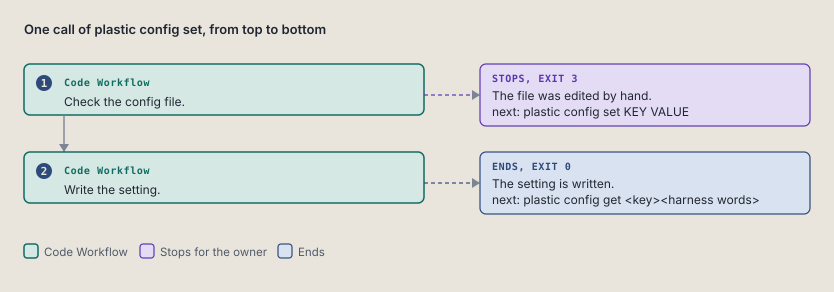

# plastic config set

Write one setting to config.yml, globally or for one harness.

```sh
plastic config set KEY VALUE [--harness NAME]
```

| Argument or option | What it gives | Default |
| --- | --- | --- |
| `KEY` | the setting, as its dotted name | |
| `VALUE` | the new value | |
| `--harness NAME` | the harness whose settings to use; the global settings when left out |  |

## The events of one call, step by step



The boxes on the left run in order. The boxes on the right are the ways the call stops or ends at that step.

## What one call changes

| What changes | Where | Reach |
| --- | --- | --- |
| The setting is written to config.yml in the Plastic home | the Plastic home folder | stays on this machine |

The command is `Plastic::Commands::Config::Set`, in [`commands/config/set.rb`](../../../../lib/plastic/commands/config/set.rb).
