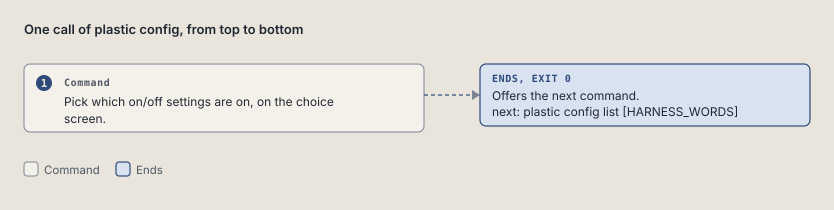

# plastic config

Pick which on/off settings are on, on the choice screen.

```sh
plastic config [ANSWER] [--harness NAME]
```

| Argument or option | What it gives | Default |
| --- | --- | --- |
| `ANSWER` | the person's answer to the numbered list | |
| `--harness NAME` | the harness whose settings to use; the global settings when left out |  |

## The events of one call, step by step



The boxes on the left run in order. The boxes on the right are the ways the call stops or ends at that step.

## What one call changes

| What changes | Where | Reach |
| --- | --- | --- |
| Each setting the person switched is written to config.yml in the Plastic home | the Plastic home folder | stays on this machine |

The command is `Plastic::Commands::Config`, in [`commands/config.rb`](../../../../lib/plastic/commands/config.rb).
