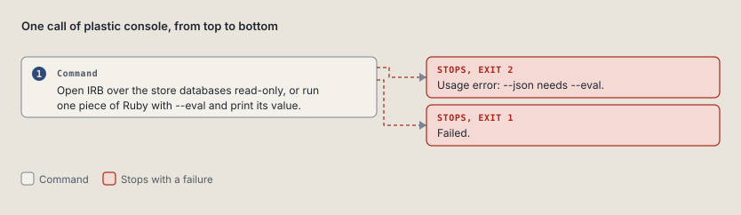

# plastic console

Open IRB over the store databases read-only, or run one piece of Ruby with --eval and print its value.

```sh
plastic console [-e, --eval CODE]
```

Opens work, knowledge, retrieval and plastic read-only: the three files of the store and plastic.db.

The console is no sandbox: Ruby can still write files.

| Argument or option | What it gives | Default |
| --- | --- | --- |
| `-e, --eval CODE` | run this Ruby once, print its value and exit |  |

## The events of one call, step by step



The boxes on the left run in order. The boxes on the right are the ways the call stops or ends at that step.

## What one call changes

This command changes nothing.

The command is `Plastic::Commands::Console`, in [`commands/console.rb`](../../../../lib/plastic/commands/console.rb).
