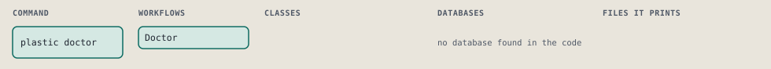
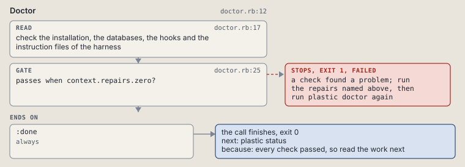
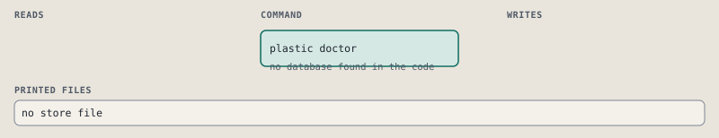

# plastic doctor

Check the installation, the databases and the hooks of this harness, and name each repair.

```sh
plastic doctor [--harness NAME]
```

The command is `Doctor`, in [`doctor.rb:7`](../../../../lib/plastic/commands/doctor.rb#L7). The words on this page, such as gate, step and outcome, are explained in [the command DSL](../../dsl/README.md).

| Argument or option | What it gives | Default |
| --- | --- | --- |
| `--harness NAME` | the harness to check, such as claude-code; the one the call runs in when left out |  |

## Components



The figure shows the command, the workflows it runs, the classes behind them, and the databases and files they reach.

## The events of one call

The call starts the workflow `Code::Doctor`, in [`doctor.rb:12`](../../../../lib/plastic/workflows/code/doctor.rb#L12).

Runs the checks of the shared parts and of one harness, prints a row for each, and names each repair once. It reads files and changes none.



Its rows run in this order:

1. Read: check the installation, the databases, the hooks and the instruction files of the harness. [`doctor.rb:17`](../../../../lib/plastic/workflows/code/doctor.rb#L17)
2. Gate: passes when `context.repairs.zero?`; otherwise the call stops with exit 1 and prints a check found a problem; run the repairs named above, then run plastic doctor again. [`doctor.rb:25`](../../../../lib/plastic/workflows/code/doctor.rb#L25)
3. Outcome `:done`, always: finishes with exit 0; next: plastic status. [`doctor.rb:28`](../../../../lib/plastic/workflows/code/doctor.rb#L28)

It sets `repairs`.

In the words of workflow engines, the rows are these four parts:

- **Trigger**: the call starts the workflow `Code::Doctor`.
- **Activities**: 1 read.
- **Transitions**: 1 gate stops the call when its check fails.
- **Outcomes**: `:done` ends the call.

## What one call reads, writes and prints



It reads and writes no store database and prints no store file.

## How a call ends

Every call can also end in [the ways any call can end](../../dsl/README.md#how-any-call-can-end).

| Ending | Exit | next: | Code |
| --- | --- | --- | --- |
| a check found a problem; run the repairs named above, then run plastic doctor again | 1 | prints no next: line | [`doctor.rb:25`](../../../../lib/plastic/workflows/code/doctor.rb#L25) |
| every check passed, so read the work next | 0 | plastic status | [`doctor.rb:28`](../../../../lib/plastic/workflows/code/doctor.rb#L28) |
| a step raises | 1 | prints no next: line | [`code_workflow.rb:102`](../../../../lib/plastic/code_workflow.rb#L102) |

## What the page leaves out

Every call shares a few things that this page does not repeat; [the command DSL](../../dsl/README.md#what-every-call-shares) names them.

- No gate of this command refuses, so exit 3 never happens.
