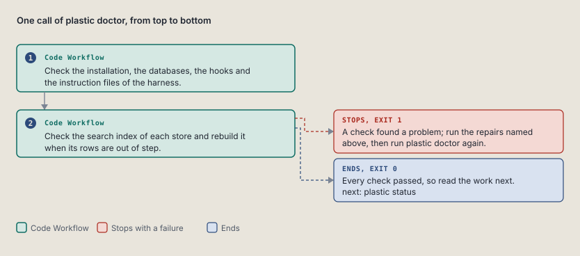

# plastic doctor

Check the installation, the databases and the hooks of this harness, rebuild a search index that is out of step, and name each repair.

```sh
plastic doctor [--harness NAME]
```

| Argument or option | What it gives | Default |
| --- | --- | --- |
| `--harness NAME` | the harness to check, such as claude-code; the one the call runs in when left out |  |

## The events of one call, step by step



The boxes on the left run in order. The boxes on the right are the ways the call stops or ends at that step.

## What one call changes

This command changes nothing.

The command is `Plastic::Commands::Doctor`, in [`commands/doctor.rb`](../../../../lib/plastic/commands/doctor.rb).
