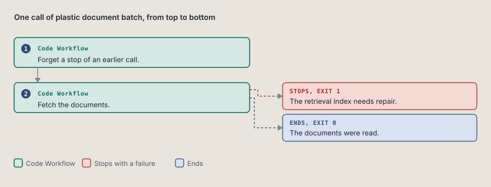

# plastic document batch

Fetch qualified documents in request order.

```sh
plastic document batch REF...
```

| Argument or option | What it gives | Default |
| --- | --- | --- |
| `REF` | one or more plastic://STORE/INTENT/PATH?revision=SHA256 references | |

## The events of one call, step by step



The boxes on the left run in order. The boxes on the right are the ways the call stops or ends at that step.

## What one call changes

This command changes nothing.

The command is `Plastic::Commands::Document::Batch`, in [`batch.rb:9`](../../../../lib/plastic/commands/document/batch.rb#L9).
