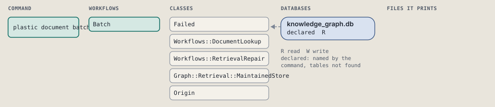
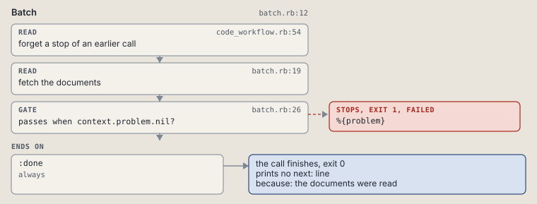
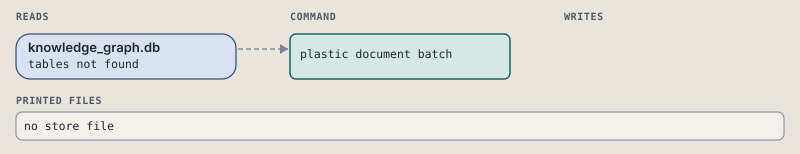

# plastic document batch

Fetch qualified documents in request order.

```sh
plastic document batch REF...
```

The command is `Document::Batch`, in [`batch.rb:9`](../../../../lib/plastic/commands/document/batch.rb#L9). The words on this page, such as gate, step and outcome, are explained in [the command DSL](../../dsl/README.md).

| Argument or option | What it gives | Default |
| --- | --- | --- |
| `REF` | one or more plastic://STORE/INTENT/PATH?revision=SHA256 references | |

## Components



The figure shows the command, the workflows it runs, the classes behind them, and the databases and files they reach.

## The events of one call

The call starts the workflow `Code::Document::Batch`, in [`batch.rb:12`](../../../../lib/plastic/workflows/code/document/batch.rb#L12).

Fetches qualified documents in the exact request order.



Its rows run in this order:

1. Read: forget a stop of an earlier call. [`code_workflow.rb:54`](../../../../lib/plastic/code_workflow.rb#L54)
2. Read: fetch the documents. [`batch.rb:19`](../../../../lib/plastic/workflows/code/document/batch.rb#L19)
3. Gate: passes when `context.problem.nil?`; otherwise the call stops with exit 1 and prints PROBLEM. [`batch.rb:26`](../../../../lib/plastic/workflows/code/document/batch.rb#L26)
4. Outcome `:done`, always: finishes with exit 0; prints no next: line. [`batch.rb:28`](../../../../lib/plastic/workflows/code/document/batch.rb#L28)

It sets `problem`.

In the words of workflow engines, the rows are these four parts:

- **Trigger**: the call starts the workflow `Code::Document::Batch`.
- **Activities**: 2 reads.
- **Transitions**: 1 gate stops the call when its check fails.
- **Outcomes**: `:done` end the call.

## What one call reads, writes and prints



| Place | Database or file | Tables | Reads or writes | Code |
| --- | --- | --- | --- | --- |
| the store folder | knowledge_graph.db | not found in the code | reads | [`batch.rb:11`](../../../../lib/plastic/commands/document/batch.rb#L11) |

## How a call ends

Every call can also end in [the ways any call can end](../../dsl/README.md#how-any-call-can-end).

| Ending | Exit | next: | Code |
| --- | --- | --- | --- |
| PROBLEM | 1 | prints no next: line | [`batch.rb:26`](../../../../lib/plastic/workflows/code/document/batch.rb#L26) |
| the documents were read | 0 | prints no next: line | [`batch.rb:28`](../../../../lib/plastic/workflows/code/document/batch.rb#L28) |
| a step raises | 1 | prints no next: line | [`code_workflow.rb:102`](../../../../lib/plastic/code_workflow.rb#L102) |

## What the page leaves out

Every call shares a few things that this page does not repeat; [the command DSL](../../dsl/README.md#what-every-call-shares) names them.

- No gate of this command refuses, so exit 3 never happens.
