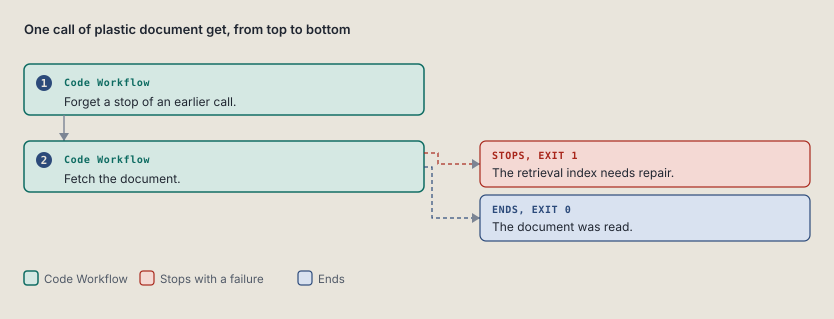

# plastic document get

Fetch one current or revision-qualified document.

```sh
plastic document get REF [--passage N]
```

| Argument or option | What it gives | Default |
| --- | --- | --- |
| `REF` | plastic://STORE/INTENT/PATH?revision=SHA256 | |
| `--passage N` | one-based bounded passage position |  |

## The events of one call, step by step



The boxes on the left run in order. The boxes on the right are the ways the call stops or ends at that step.

## What one call changes

This command changes nothing.

The command is `Plastic::Commands::Document::Get`, in [`commands/document/get.rb`](../../../../lib/plastic/commands/document/get.rb).
