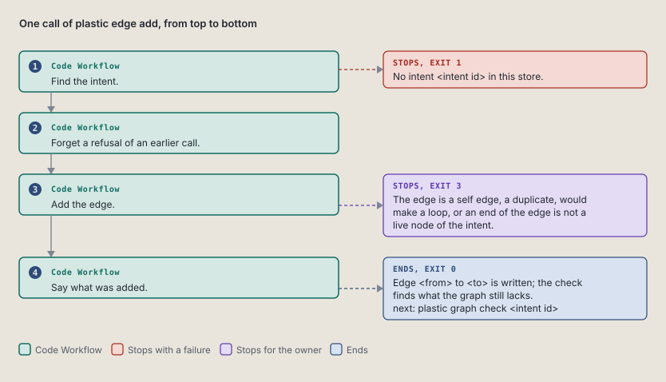

# plastic edge add

Add a needs edge between two nodes.

```sh
plastic edge add ID FROM TO
```

| Argument or option | What it gives | Default |
| --- | --- | --- |
| `ID` | the intent | |
| `FROM` | the node that must be done first | |
| `TO` | the node that waits on it | |

## The events of one call, step by step



The boxes on the left run in order. The boxes on the right are the ways the call stops or ends at that step.

## What one call changes

| What changes | Where | Reach |
| --- | --- | --- |
| An edge between two nodes of the intent is added | the work graph database, in the store folder | goes with the store |
| The files of the intent and the index of the store are rewritten | the store folder | goes with the store |

Goes with the store: the files of the store carry the change, and `plastic sync up` rebuilds it on another machine. The database files themselves stay on this machine.

The command is `Plastic::Commands::Edge::Add`, in [`add.rb:10`](../../../../lib/plastic/commands/edge/add.rb#L10).
