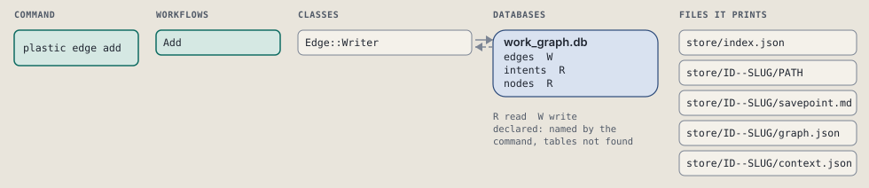
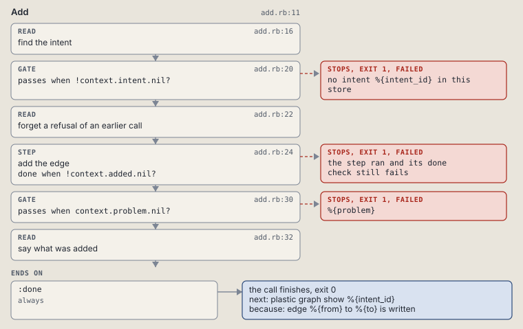
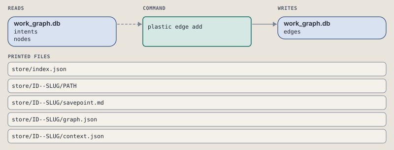

# plastic edge add

Add a needs edge between two nodes.

Adds a needs edge between two nodes of the same intent, guarded against a self edge, a missing or removed node, and a loop.

```sh
plastic edge add ID FROM TO
```

The command is `Edge::Add`, in [`add.rb:10`](../../../../lib/plastic/commands/edge/add.rb#L10). The words on this page, such as gate, step and outcome, are explained in [the command DSL](../../dsl/README.md).

| Argument or option | What it gives | Default |
| --- | --- | --- |
| `ID` | the intent | |
| `FROM` | the node that must be done first | |
| `TO` | the node that waits on it | |

## Components



The figure shows the command, the workflows it runs, the classes behind them, and the databases and files they reach.

## The events of one call

The call starts the workflow `Code::Edge::Add`, in [`add.rb:11`](../../../../lib/plastic/workflows/code/edge/add.rb#L11).

Writes one guarded edge: fails on a self edge, a missing or removed node, or a loop back to its own start.



Its rows run in this order:

1. Read: find the intent. [`add.rb:16`](../../../../lib/plastic/workflows/code/edge/add.rb#L16)
2. Gate: passes when `!context.intent.nil?`; otherwise the call stops with exit 1 and prints no intent INTENT_ID in this store. [`add.rb:20`](../../../../lib/plastic/workflows/code/edge/add.rb#L20)
3. Read: forget a refusal of an earlier call. [`add.rb:22`](../../../../lib/plastic/workflows/code/edge/add.rb#L22)
4. Step: add the edge. Done when `!context.added.nil?`, so a second call skips it. [`add.rb:24`](../../../../lib/plastic/workflows/code/edge/add.rb#L24)
5. Gate: passes when `context.problem.nil?`; otherwise the call stops with exit 1 and prints PROBLEM. [`add.rb:30`](../../../../lib/plastic/workflows/code/edge/add.rb#L30)
6. Read: say what was added. [`add.rb:32`](../../../../lib/plastic/workflows/code/edge/add.rb#L32)
7. Outcome `:done`, always: finishes with exit 0; next: plastic graph show INTENT_ID. [`add.rb:36`](../../../../lib/plastic/workflows/code/edge/add.rb#L36)

It sets `intent`, `problem`, `added`.

In the words of workflow engines, the rows are these four parts:

- **Trigger**: the call starts the workflow `Code::Edge::Add`.
- **Activities**: 3 reads and 1 step.
- **Transitions**: 2 gates stop the call when their checks fail; a step runs only while its done check fails.
- **Outcomes**: `:done` end the call.

## What one call reads, writes and prints



| Place | Database or file | Tables | Reads or writes | Code |
| --- | --- | --- | --- | --- |
| the store folder | work_graph.db | `edges`, `intents`, `nodes` | reads and writes | [`add.rb:14`](../../../../lib/plastic/commands/edge/add.rb#L14) |
| the store folder | store/index.json | | writes | [`prints.rb:14`](../../../../lib/plastic/graph/prints.rb#L14) |
| the store folder | store/ID--SLUG/PATH | | writes | [`prints.rb:15`](../../../../lib/plastic/graph/prints.rb#L15) |
| the store folder | store/ID--SLUG/savepoint.md | | writes | [`prints.rb:16`](../../../../lib/plastic/graph/prints.rb#L16) |
| the store folder | store/ID--SLUG/graph.json | | writes | [`prints.rb:17`](../../../../lib/plastic/graph/prints.rb#L17) |
| the store folder | store/ID--SLUG/context.json | | writes | [`prints.rb:18`](../../../../lib/plastic/graph/prints.rb#L18) |

A second call runs the same rows again. A step runs again only when its done check fails.

| Step | Done when | The second call | Code |
| --- | --- | --- | --- |
| add the edge | `!context.added.nil?` | skips it | [`add.rb:24`](../../../../lib/plastic/workflows/code/edge/add.rb#L24) |

## How a call ends

Every call can also end in [the ways any call can end](../../dsl/README.md#how-any-call-can-end).

| Ending | Exit | next: | Code |
| --- | --- | --- | --- |
| no intent INTENT_ID in this store | 1 | prints no next: line | [`add.rb:20`](../../../../lib/plastic/workflows/code/edge/add.rb#L20) |
| PROBLEM | 1 | prints no next: line | [`add.rb:30`](../../../../lib/plastic/workflows/code/edge/add.rb#L30) |
| edge FROM to TO is written | 0 | plastic graph show INTENT_ID | [`add.rb:36`](../../../../lib/plastic/workflows/code/edge/add.rb#L36) |
| a step raises | 1 | prints no next: line | [`code_workflow.rb:102`](../../../../lib/plastic/code_workflow.rb#L102) |

## What the page leaves out

Every call shares a few things that this page does not repeat; [the command DSL](../../dsl/README.md#what-every-call-shares) names them.

- No gate of this command refuses, so exit 3 never happens.
- A call that writes saves a routine run row in local.db. A stop by a gate or a step saves the run, and the next call resumes from it. A dry run saves no row.
