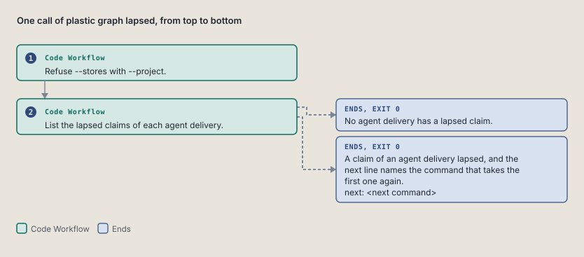

# plastic graph lapsed

List the agent deliveries whose claims lapsed and the command that restarts each.

```sh
plastic graph lapsed [--stores LIST]
```

| Argument or option | What it gives | Default |
| --- | --- | --- |
| `--stores LIST` | the stores to read, comma separated: registered projects or global; the call's own store when left out |  |

## The events of one call, step by step



The boxes on the left run in order. The boxes on the right are the ways the call stops or ends at that step.

## What one call changes

This command changes nothing.

The command is `Plastic::Commands::Graph::Lapsed`, in [`commands/graph/lapsed.rb`](../../../../lib/plastic/commands/graph/lapsed.rb).
