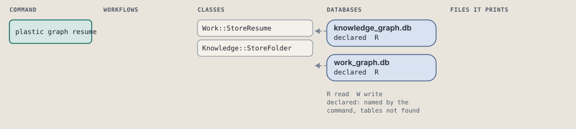
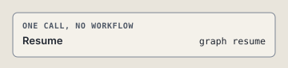
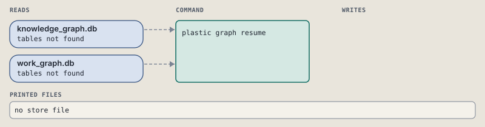

# plastic graph resume

Say where each named store's work stopped and what runs next.

```sh
plastic graph resume [--stores LIST]
```

The command is `Graph::Resume`, in [`resume.rb:14`](../../../../lib/plastic/commands/graph/resume.rb#L14). The words on this page, such as gate, step and outcome, are explained in [the command DSL](../../dsl/README.md).

| Argument or option | What it gives | Default |
| --- | --- | --- |
| `--stores LIST` | the stores to read, comma separated: registered projects or global; the call's own store when left out |  |

## Components



The figure shows the command, the workflows it runs, the classes behind them, and the databases and files they reach.

## The events of one call



The command's `call`, at [`resume.rb:20`](../../../../lib/plastic/commands/graph/resume.rb#L20):

```ruby
def call
  refuse_project
  offer_next(store_slugs.map { |slug| report(slug) }.each { |found| print_rows(found) })
end
```

Its steps run in this order:

1. `refuse_project` [`resume.rb:21`](../../../../lib/plastic/commands/graph/resume.rb#L21)
2. `offer_next(store_slugs.map { |slug| report(slug) }.each { |found| print_rows(found) })` [`resume.rb:22`](../../../../lib/plastic/commands/graph/resume.rb#L22)

## What one call reads, writes and prints



| Place | Database or file | Tables | Reads or writes | Code |
| --- | --- | --- | --- | --- |
| the store folder | knowledge_graph.db | not found in the code | reads | [`resume.rb:17`](../../../../lib/plastic/commands/graph/resume.rb#L17) |
| the store folder | work_graph.db | not found in the code | reads | [`resume.rb:17`](../../../../lib/plastic/commands/graph/resume.rb#L17) |

## How a call ends

Every call can also end in [the ways any call can end](../../dsl/README.md#how-any-call-can-end).

| Ending | Exit | next: | Code |
| --- | --- | --- | --- |
| Usage error: --stores names the stores; --project does not apply | 2 | prints no next: line | [`resume.rb:32`](../../../../lib/plastic/commands/graph/resume.rb#L32) |
| Usage error: name at least one store after --stores | 2 | prints no next: line | [`resume.rb:42`](../../../../lib/plastic/commands/graph/resume.rb#L42) |
| Usage error: no registered project named NAME; the projects are PROJECTS | 2 | prints no next: line | [`resume.rb:51`](../../../../lib/plastic/commands/graph/resume.rb#L51) |
| Offers the next command | 0 | plastic status | [`resume.rb:63`](../../../../lib/plastic/commands/graph/resume.rb#L63) |
| Offers the next command | 0 | decided at run time | [`resume.rb:71`](../../../../lib/plastic/commands/graph/resume.rb#L71) |

## What the page leaves out

Every call shares a few things that this page does not repeat; [the command DSL](../../dsl/README.md#what-every-call-shares) names them.

- No gate of this command refuses, so exit 3 never happens.
