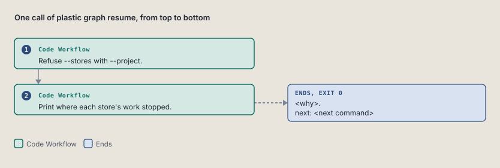

# plastic graph resume

Say where each named store's work stopped and what runs next.

```sh
plastic graph resume [--stores LIST]
```

| Argument or option | What it gives | Default |
| --- | --- | --- |
| `--stores LIST` | the stores to read, comma separated: registered projects or global; the call's own store when left out |  |

## The events of one call, step by step



The boxes on the left run in order. The boxes on the right are the ways the call stops or ends at that step.

## What one call changes

This command changes nothing.

The command is `Plastic::Commands::Graph::Resume`, in [`commands/graph/resume.rb`](../../../../lib/plastic/commands/graph/resume.rb).
