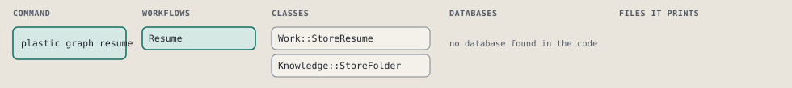
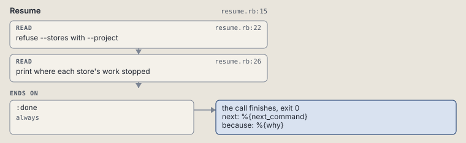
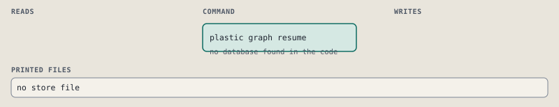

# plastic graph resume

Say where each named store's work stopped and what runs next.

```sh
plastic graph resume [--stores LIST]
```

The command is `Graph::Resume`, in [`resume.rb:10`](../../../../lib/plastic/commands/graph/resume.rb#L10). The words on this page, such as gate, step and outcome, are explained in [the command DSL](../../dsl/README.md).

| Argument or option | What it gives | Default |
| --- | --- | --- |
| `--stores LIST` | the stores to read, comma separated: registered projects or global; the call's own store when left out |  |

## Components



The figure shows the command, the workflows it runs, the classes behind them, and the databases and files they reach.

## The events of one call

The call starts the workflow `Code::Graph::Resume`, in [`resume.rb:15`](../../../../lib/plastic/workflows/code/graph/resume.rb#L15).

Says where each named store's work stopped and what runs next. It reads the rows and writes nothing.



Its rows run in this order:

1. Read: refuse --stores with --project. [`resume.rb:22`](../../../../lib/plastic/workflows/code/graph/resume.rb#L22)
2. Read: print where each store's work stopped. [`resume.rb:26`](../../../../lib/plastic/workflows/code/graph/resume.rb#L26)
3. Outcome `:done`, always: finishes with exit 0; next: NEXT_COMMAND. [`resume.rb:32`](../../../../lib/plastic/workflows/code/graph/resume.rb#L32)

It sets `next_command`, `why`.

In the words of workflow engines, the rows are these four parts:

- **Trigger**: the call starts the workflow `Code::Graph::Resume`.
- **Activities**: 2 reads.
- **Transitions**: .
- **Outcomes**: `:done` ends the call.

## What one call reads, writes and prints



It reads and writes no store database and prints no store file.

## How a call ends

Every call can also end in [the ways any call can end](../../dsl/README.md#how-any-call-can-end).

| Ending | Exit | next: | Code |
| --- | --- | --- | --- |
| WHY | 0 | NEXT_COMMAND | [`resume.rb:32`](../../../../lib/plastic/workflows/code/graph/resume.rb#L32) |
| a step raises | 1 | prints no next: line | [`code_workflow.rb:107`](../../../../lib/plastic/code_workflow.rb#L107) |

## What the page leaves out

Every call shares a few things that this page does not repeat; [the command DSL](../../dsl/README.md#what-every-call-shares) names them.

- No gate of this command refuses, so exit 3 never happens.
