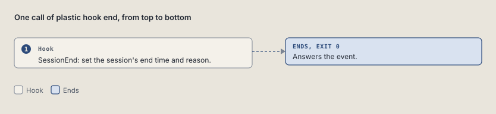

# plastic hook end

SessionEnd: set the session's end time and reason.

```sh
plastic hook end
```

## The events of one call, step by step



The boxes on the left run in order. The boxes on the right are the ways the call stops or ends at that step.

## What one call changes

| What changes | Where | Reach |
| --- | --- | --- |
| The end time and the reason are written to the session row | the local database, in the home folder | stays on this machine |

The command is `Plastic::Hooks::End`, in [`hooks/end.rb`](../../../../lib/plastic/hooks/end.rb).
