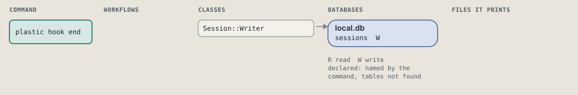
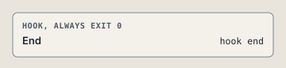
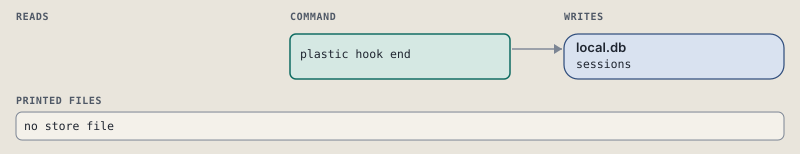

# plastic hook end

SessionEnd: set the session's end time and reason.

```sh
plastic hook end
```

The command is `Hooks::End`, in [`end.rb:9`](../../../../lib/plastic/hooks/end.rb#L9). The words on this page, such as gate, step and outcome, are explained in [the command DSL](../../dsl/README.md).

## Components



The figure shows the command, the workflows it runs, the classes behind them, and the databases and files they reach.

## The events of one call



The hook's `respond`, at [`end.rb:10`](../../../../lib/plastic/hooks/end.rb#L10):

```ruby
def respond(event)
  return no_session unless session_id

  Graph.open(home: scope.plastic_home, store: scope.slug, session: session_id).work.end_session(session_id, reason: event[:reason])
  nil
end
```

Its steps run in this order:

1. `return no_session unless session_id` [`end.rb:11`](../../../../lib/plastic/hooks/end.rb#L11)
2. `Graph.open(home: scope.plastic_home, store: scope.slug, session: session_id).work.end_session(session_id, reason: event[:reason])` [`end.rb:13`](../../../../lib/plastic/hooks/end.rb#L13)
3. `nil` [`end.rb:14`](../../../../lib/plastic/hooks/end.rb#L14)

## What one call reads, writes and prints



| Place | Database or file | Tables | Reads or writes | Code |
| --- | --- | --- | --- | --- |
| the home folder | local.db | `sessions` | writes | found in the code, not declared |

## How a call ends

Every call can also end in [the ways any call can end](../../dsl/README.md#how-any-call-can-end).

| Ending | Exit | next: | Code |
| --- | --- | --- | --- |
| answers the event | 0 | prints no next: line | [`end.rb:10`](../../../../lib/plastic/hooks/end.rb#L10) |

## What the page leaves out

Every call shares a few things that this page does not repeat; [the command DSL](../../dsl/README.md#what-every-call-shares) names them.

- No gate of this command refuses, so exit 3 never happens.
