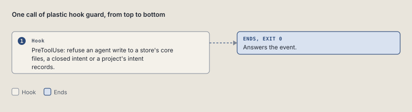

# plastic hook guard

PreToolUse: refuse an agent write to a store's core files, a closed intent or a project's intent records.

```sh
plastic hook guard
```

## The events of one call, step by step



The boxes on the left run in order. The boxes on the right are the ways the call stops or ends at that step.

## What one call changes

This command changes nothing.

The command is `Plastic::Hooks::Guard`, in [`hooks/guard.rb`](../../../../lib/plastic/hooks/guard.rb).
