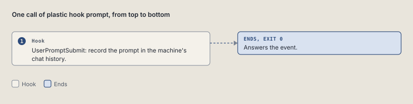

# plastic hook prompt

UserPromptSubmit: record the prompt in the machine's chat history.

```sh
plastic hook prompt
```

## The events of one call, step by step



The boxes on the left run in order. The boxes on the right are the ways the call stops or ends at that step.

## What one call changes

| What changes | Where | Reach |
| --- | --- | --- |
| The prompt is added to the chat history in plastic.db | the local database, in the home folder | stays on this machine |

The command is `Plastic::Hooks::Prompt`, in [`hooks/prompt.rb`](../../../../lib/plastic/hooks/prompt.rb).
