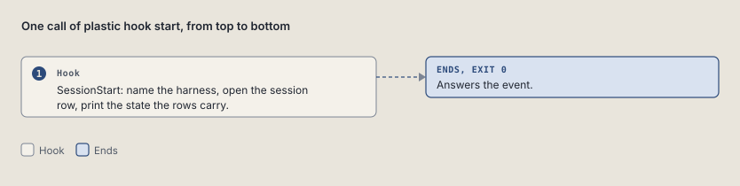

# plastic hook start

SessionStart: name the harness, open the session row, print the state the rows carry.

SessionStart: names the harness, opens the session row with it, then prints the Recap the rows alone carry, and, on a session that starts fresh, one line naming plastic doctor when a doctor check fails or when the harness it recorded is not registered. Nothing here is call memory: a hook keeps no routine run.

```sh
plastic hook start
```

## The events of one call, step by step



The boxes on the left run in order. The boxes on the right are the ways the call stops or ends at that step.

## What one call changes

| What changes | Where | Reach |
| --- | --- | --- |
| The databases of the store are kept out of its versioning | the store folder | goes with the store |
| The session row of the call is opened or kept | the local database, in the home folder | stays on this machine |

Goes with the store: the files of the store carry the change, and `plastic sync up` rebuilds it on another machine. The database files themselves stay on this machine.

The command is `Plastic::Hooks::Start`, in [`start.rb:17`](../../../../lib/plastic/hooks/start.rb#L17).
