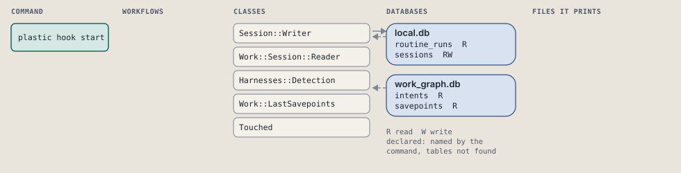
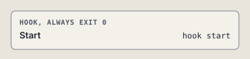
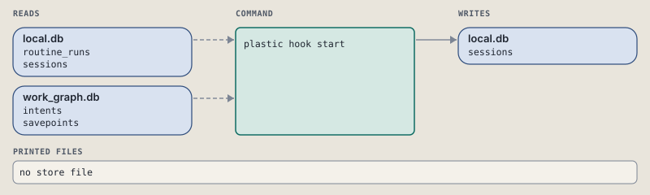

# plastic hook start

SessionStart: name the harness, open the session row, print the state the rows carry.

SessionStart: names the harness, opens the session row with it, then prints the Recap the rows alone carry, and, on a session that starts fresh, one line naming plastic doctor when a doctor check fails or when the harness it recorded is not registered. Nothing here is call memory: a hook keeps no routine run.

```sh
plastic hook start
```

The command is `Hooks::Start`, in [`start.rb:17`](../../../../lib/plastic/hooks/start.rb#L17). The words on this page, such as gate, step and outcome, are explained in [the command DSL](../../dsl/README.md).

## Components



The figure shows the command, the workflows it runs, the classes behind them, and the databases and files they reach.

## The events of one call



The hook's `respond`, at [`start.rb:25`](../../../../lib/plastic/hooks/start.rb#L25):

```ruby
def respond(event)
  doctor = DoctorLine.new(scope, harness, session_id:, health: @health, err: environment.err)
  [*recap(event), doctor.line(event[:source])].compact.join("\n")
end
```

Its steps run in this order:

1. `doctor = DoctorLine.new(scope, harness, session_id:, health: @health, err: environment.err)` [`start.rb:26`](../../../../lib/plastic/hooks/start.rb#L26)
2. `[*recap(event), doctor.line(event[:source])].compact.join("\n")` [`start.rb:27`](../../../../lib/plastic/hooks/start.rb#L27)

## What one call reads, writes and prints



| Place | Database or file | Tables | Reads or writes | Code |
| --- | --- | --- | --- | --- |
| the home folder | local.db | `routine_runs`, `sessions` | reads and writes | found in the code, not declared |
| the store folder | work_graph.db | `intents`, `savepoints` | reads | found in the code, not declared |

## How a call ends

Every call can also end in [the ways any call can end](../../dsl/README.md#how-any-call-can-end).

| Ending | Exit | next: | Code |
| --- | --- | --- | --- |
| answers the event | 0 | prints no next: line | [`start.rb:25`](../../../../lib/plastic/hooks/start.rb#L25) |

## What the page leaves out

Every call shares a few things that this page does not repeat; [the command DSL](../../dsl/README.md#what-every-call-shares) names them.

- No gate of this command refuses, so exit 3 never happens.
