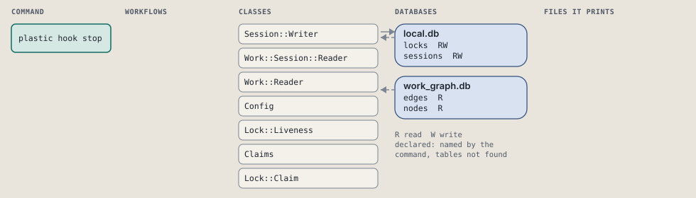
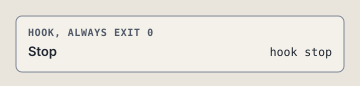
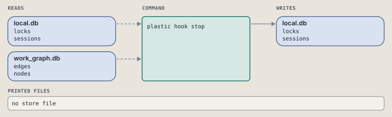

# plastic hook stop

Stop: stamp the turn, renew locks, run the stop gate.

```sh
plastic hook stop
```

The command is `Hooks::Stop`, in [`stop.rb:14`](../../../../lib/plastic/hooks/stop.rb#L14). The words on this page, such as gate, step and outcome, are explained in [the command DSL](../../dsl/README.md).

## Components



The figure shows the command, the workflows it runs, the classes behind them, and the databases and files they reach.

## The events of one call



The hook's `respond`, at [`stop.rb:15`](../../../../lib/plastic/hooks/stop.rb#L15):

```ruby
def respond(event)
  return no_session unless session_id

  stop(event)
end
```

Its steps run in this order:

1. `return no_session unless session_id` [`stop.rb:16`](../../../../lib/plastic/hooks/stop.rb#L16)
2. `stop(event)` [`stop.rb:18`](../../../../lib/plastic/hooks/stop.rb#L18)

## What one call reads, writes and prints



| Place | Database or file | Tables | Reads or writes | Code |
| --- | --- | --- | --- | --- |
| the home folder | local.db | `locks`, `sessions` | reads and writes | found in the code, not declared |
| the store folder | work_graph.db | `edges`, `nodes` | reads | found in the code, not declared |

## How a call ends

Every call can also end in [the ways any call can end](../../dsl/README.md#how-any-call-can-end).

| Ending | Exit | next: | Code |
| --- | --- | --- | --- |
| answers the event | 0 | prints no next: line | [`stop.rb:15`](../../../../lib/plastic/hooks/stop.rb#L15) |
| blocks the stop | 0 | prints no next: line | [`stop_gate.rb:24`](../../../../lib/plastic/hooks/stop_gate.rb#L24) |

## What the page leaves out

Every call shares a few things that this page does not repeat; [the command DSL](../../dsl/README.md#what-every-call-shares) names them.

- No gate of this command refuses, so exit 3 never happens.
