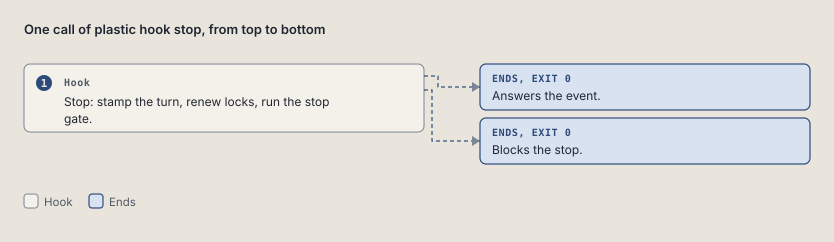

# plastic hook stop

Stop: stamp the turn, renew claims, run the stop gate.

```sh
plastic hook stop
```

## The events of one call, step by step



The boxes on the left run in order. The boxes on the right are the ways the call stops or ends at that step.

## What one call changes

| What changes | Where | Reach |
| --- | --- | --- |
| The last turn of the session is stamped | the local database, in the home folder | stays on this machine |
| The node claims of the session are renewed | the work graph database, in the store folder | stays on this machine |

The command is `Plastic::Hooks::Stop`, in [`hooks/stop.rb`](../../../../lib/plastic/hooks/stop.rb).
