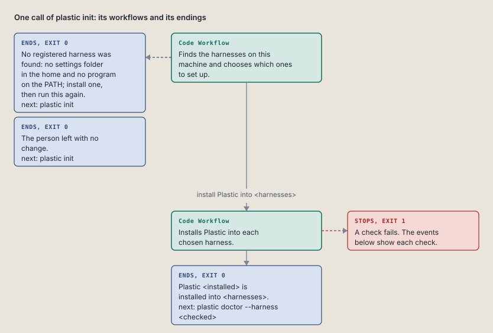
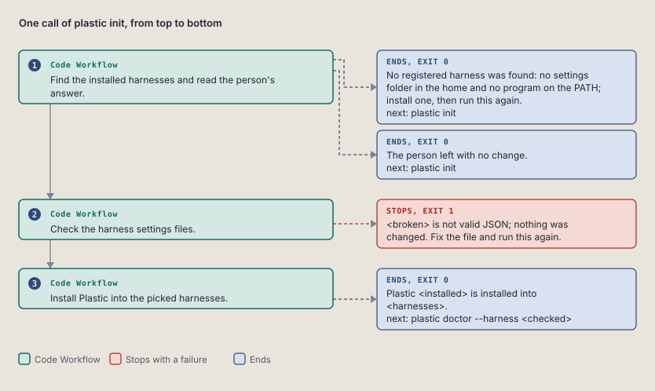

# plastic init

Find the installed harnesses and install Plastic into the ones the person picks.

```sh
plastic init [ANSWER]
```

| Argument or option | What it gives | Default |
| --- | --- | --- |
| `ANSWER` | the person's answer to the numbered list | |

## The workflows of one call



Each box is a workflow. The words between the boxes say when the call moves on, and the last boxes say how the call ends.

## The events of one call, step by step



The boxes on the left run in order. The boxes on the right are the ways the call stops or ends at that step.

## What one call changes

| What changes | Where | Reach |
| --- | --- | --- |
| Plastic is installed into the Plastic home | the Plastic home folder | stays on this machine |
| Whether a sync keeps images and videos is written to config.yml | the Plastic home folder | stays on this machine |
| The instructions and hooks of each picked harness are written | the settings of the agent harness, in the home folder | stays on this machine |

The command is `Plastic::Commands::Init`, in [`commands/init.rb`](../../../../lib/plastic/commands/init.rb).
