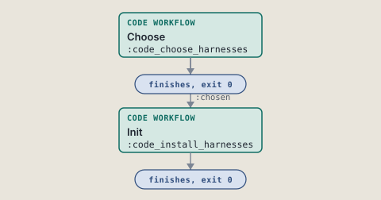
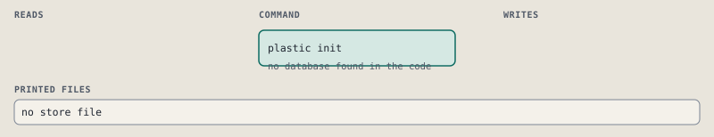

# plastic init

Find the installed harnesses and install Plastic into the ones the person picks.

Finds the installed harnesses, shows them on the choice screen with every found one picked, and installs Plastic into each one the person picks. See docs/help/choice-screen.md.

```sh
plastic init [ANSWER]
```

The command is `Init`, in [`init.rb:12`](../../../../lib/plastic/commands/init.rb#L12). The words on this page, such as gate, step and outcome, are explained in [the command DSL](../../dsl/README.md).

| Argument or option | What it gives | Default |
| --- | --- | --- |
| `ANSWER` | the person's answer to the numbered list | |

## Components


The figure shows the command, the workflows it runs, the classes behind them, and the databases and files they reach.

## The events of one call



| Workflow | Kind | Code |
| --- | --- | --- |
| [Code::Init::Choose](#codeinitchoose) | code | [`choose.rb:14`](../../../../lib/plastic/workflows/code/init/choose.rb#L14) |
| [Code::Init](#codeinit) | code | [`init.rb:13`](../../../../lib/plastic/workflows/code/init.rb#L13) |

### The command's own call

The command's own `call`, at [`harness_pick.rb:12`](../../../../lib/plastic/commands/harness_pick.rb#L12), runs first, then starts the workflow [Code::Init::Choose](#codeinitchoose).

```ruby
def call
  answer = parsed[:answer] ||= answered_on_screen
  super if answer
end
```

### Code::Init::Choose

The code workflow `:code_choose_harnesses`, in [`choose.rb:14`](../../../../lib/plastic/workflows/code/init/choose.rb#L14).

Reads the person's answer against the installed harnesses, every one of them picked at the start.


Its rows run in this order:

1. Read: find the installed harnesses and read the person's answer. [`choose.rb:19`](../../../../lib/plastic/workflows/code/init/choose.rb#L19)
2. Outcome `:none`, when `context.found.empty?`: finishes with exit 0; next: plastic init. [`choose.rb:28`](../../../../lib/plastic/workflows/code/init/choose.rb#L28)
3. Outcome `:left`, when `context.picked.empty?`: finishes with exit 0; next: plastic init. [`choose.rb:30`](../../../../lib/plastic/workflows/code/init/choose.rb#L30)
4. Outcome `:chosen`, otherwise: starts the workflow [Code::Init](#codeinit). [`choose.rb:32`](../../../../lib/plastic/workflows/code/init/choose.rb#L32)

It sets `found`, `picked`, `harnesses`.

### Code::Init

The code workflow `:code_install_harnesses`, in [`init.rb:13`](../../../../lib/plastic/workflows/code/init.rb#L13).

Checks the machine, copies the core files on a home that has none, and installs Plastic into each picked harness.


Its rows run in this order:

1. Read: check this machine and the harness settings files. [`init.rb:18`](../../../../lib/plastic/workflows/code/init.rb#L18)
2. Gate: passes when `context.usable`; otherwise the call stops with exit 1 and prints this machine cannot run Plastic; see above. [`init.rb:25`](../../../../lib/plastic/workflows/code/init.rb#L25)
3. Gate: passes when `context.broken.nil?`; otherwise the call stops with exit 1 and prints BROKEN is not valid JSON; nothing was changed. Fix the file and run this again. [`init.rb:26`](../../../../lib/plastic/workflows/code/init.rb#L26)
4. Step: install Plastic into the picked harnesses. Done when `!context.installed.nil?`, so a second call skips it. [`init.rb:29`](../../../../lib/plastic/workflows/code/init.rb#L29)
5. Outcome `:done`, always: finishes with exit 0; next: plastic doctor --harness CHECKED. [`init.rb:37`](../../../../lib/plastic/workflows/code/init.rb#L37)

It sets `usable`, `broken`, `installed`, `checked`.

In the words of workflow engines, the rows are these four parts:

- **Trigger**: the call starts the workflow `Code::Init::Choose`; each later workflow starts from an outcome of the one before it.
- **Activities**: 2 reads and 1 step.
- **Transitions**: 2 gates stop the call when their checks fail; a step runs only while its done check fails; Choose goes to Init on `:chosen`.
- **Outcomes**: `:none` of Choose, `:left` of Choose, `:done` of Init end the call.

## What one call reads, writes and prints



It reads and writes no store database and prints no store file.

A second call runs the same rows again. A step runs again only when its done check fails.

| Step | Done when | The second call | Code |
| --- | --- | --- | --- |
| install Plastic into the picked harnesses | `!context.installed.nil?` | skips it | [`init.rb:29`](../../../../lib/plastic/workflows/code/init.rb#L29) |

## How a call ends

Every call can also end in [the ways any call can end](../../dsl/README.md#how-any-call-can-end).

| Ending | Exit | next: | Code |
| --- | --- | --- | --- |
| no registered harness was found: no settings folder in the home and no program on the PATH; install one, then run this again | 0 | plastic init | [`choose.rb:28`](../../../../lib/plastic/workflows/code/init/choose.rb#L28) |
| the person left with no change | 0 | plastic init | [`choose.rb:30`](../../../../lib/plastic/workflows/code/init/choose.rb#L30) |
| this machine cannot run Plastic; see above | 1 | prints no next: line | [`init.rb:25`](../../../../lib/plastic/workflows/code/init.rb#L25) |
| BROKEN is not valid JSON; nothing was changed. Fix the file and run this again | 1 | prints no next: line | [`init.rb:26`](../../../../lib/plastic/workflows/code/init.rb#L26) |
| Plastic INSTALLED is installed into HARNESSES | 0 | plastic doctor --harness CHECKED | [`init.rb:37`](../../../../lib/plastic/workflows/code/init.rb#L37) |
| a step raises | 1 | prints no next: line | [`code_workflow.rb:102`](../../../../lib/plastic/code_workflow.rb#L102) |

## What the page leaves out

Every call shares a few things that this page does not repeat; [the command DSL](../../dsl/README.md#what-every-call-shares) names them.

- No gate of this command refuses, so exit 3 never happens.
