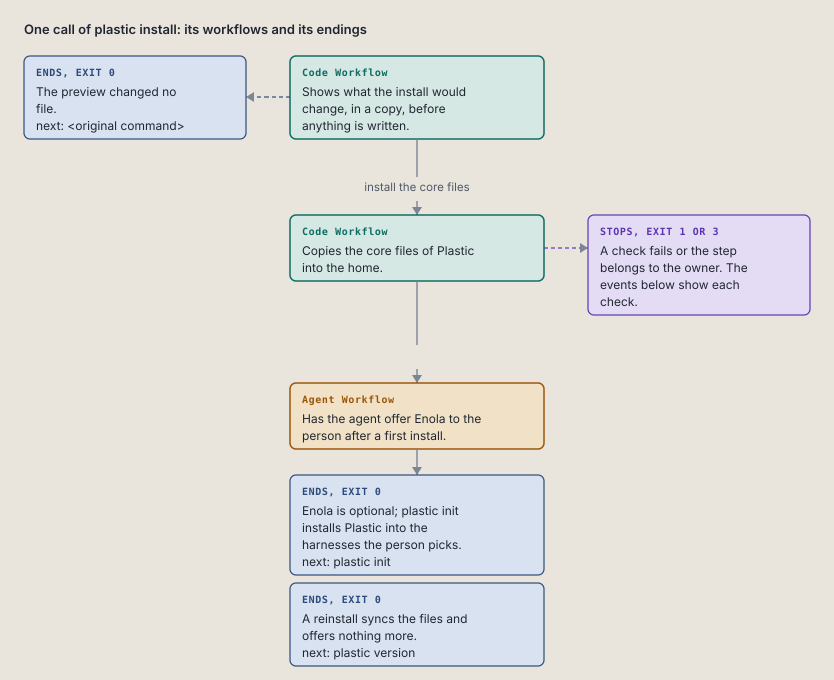
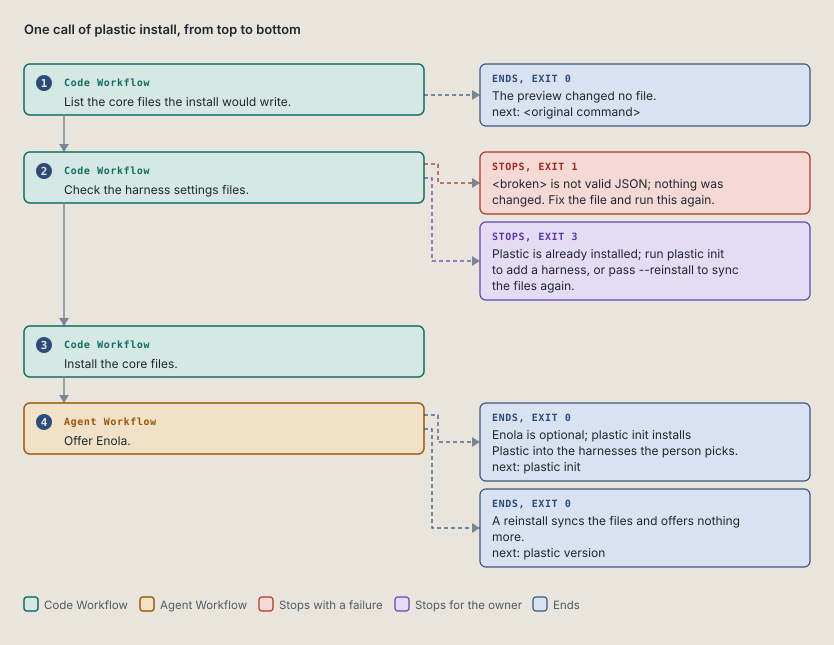

# plastic install

Install the core files and make the global store.

```sh
plastic install [--reinstall] [--dry-run]
```

| Argument or option | What it gives | Default |
| --- | --- | --- |
| `--reinstall` | sync the files again and make the global store and plastic.db when they are missing or behind | `false` |
| `--dry-run` | list what would change and change nothing | `false` |

## The workflows of one call



Each box is a workflow. The words between the boxes say when the call moves on, and the last boxes say how the call ends.

## The events of one call, step by step



The boxes on the left run in order. The boxes on the right are the ways the call stops or ends at that step.

## What one call changes

| What changes | Where | Reach |
| --- | --- | --- |
| The core files are copied into the Plastic home | the Plastic home folder | stays on this machine |

## What the agent workflow steps print

| Step | The text the agent gets |
| --- | --- |
| 4 | Enola maps the code architecture of a project. It is optional: Plastic works without it. To install it, read the release notes and run its installer from https://github.com/enola-labs/enola/releases/tag/v0.4.39, then set up Enola's hooks and its MCP server for this harness |

The command is `Plastic::Commands::Install`, in [`commands/install.rb`](../../../../lib/plastic/commands/install.rb).
