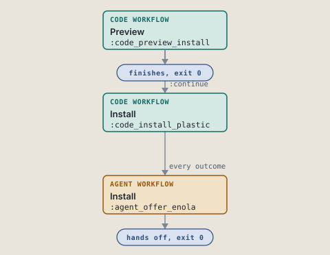

# plastic install

Install the core files and make the global store.

Copies the core files of the running package into the home and makes the global store. `plastic init` installs Plastic into the harnesses.

```sh
plastic install [--reinstall] [--force] [--dry-run]
```

The command is `Install`, in [`install.rb:9`](../../../../lib/plastic/commands/install.rb#L9). The words on this page, such as gate, step and outcome, are explained in [the command DSL](../../dsl/README.md).

| Argument or option | What it gives | Default |
| --- | --- | --- |
| `--reinstall` | sync the files again and make the global store and local.db when they are missing or behind | `false` |
| `--force` | replace agent files Plastic did not write | `false` |
| `--dry-run` | list what would change and change nothing | `false` |

## What it touches


## How the call flows



| Workflow | Kind | Code |
| --- | --- | --- |
| [Code::Install::Preview](#codeinstallpreview) | code | [`preview.rb:12`](../../../../lib/plastic/workflows/code/install/preview.rb#L12) |
| [Code::Install](#codeinstall) | code | [`install.rb:12`](../../../../lib/plastic/workflows/code/install.rb#L12) |
| [Agent::Install](#agentinstall) | agent | [`install.rb:10`](../../../../lib/plastic/workflows/agent/install.rb#L10) |

### Code::Install::Preview

The code workflow `:code_preview_install`, in [`preview.rb:12`](../../../../lib/plastic/workflows/code/install/preview.rb#L12).

On a dry run, lists each core file the install would add or replace.


| Step | Kind | Check | Code |
| --- | --- | --- | --- |
| list the core files the install would write | read |  | [`preview.rb:15`](../../../../lib/plastic/workflows/code/install/preview.rb#L15) |

| Outcome | When | Then | Code |
| --- | --- | --- | --- |
| `:done` | when `context.dry_run` | finishes, exit 0; next: %{original_command} | [`preview.rb:23`](../../../../lib/plastic/workflows/code/install/preview.rb#L23) |
| `:continue` | otherwise | runs [Code::Install](#codeinstall) | [`preview.rb:25`](../../../../lib/plastic/workflows/code/install/preview.rb#L25) |

### Code::Install

The code workflow `:code_install_plastic`, in [`install.rb:12`](../../../../lib/plastic/workflows/code/install.rb#L12).

Checks the machine, then copies the core files into the home. A reinstall also syncs the harnesses Plastic is installed into.


| Step | Kind | Check | Code |
| --- | --- | --- | --- |
| check this machine and the harness settings files | read |  | [`install.rb:17`](../../../../lib/plastic/workflows/code/install.rb#L17) |
| this machine cannot run Plastic; see above | gate, stops with exit 1 | `context.usable` | [`install.rb:26`](../../../../lib/plastic/workflows/code/install.rb#L26) |
| %{broken} is not valid JSON; nothing was changed. Fix the file and run this again | gate, stops with exit 1 | `context.broken.nil?` | [`install.rb:27`](../../../../lib/plastic/workflows/code/install.rb#L27) |
| Plastic is already installed; run plastic init to add a harness, or pass --reinstall to sync the files again | gate, stops with exit 3 | `context.reinstall \|\| !context.present` | [`install.rb:29`](../../../../lib/plastic/workflows/code/install.rb#L29) |
| install the core files | step | `!context.installed.nil?` | [`install.rb:32`](../../../../lib/plastic/workflows/code/install.rb#L32) |

| Outcome | When | Then | Code |
| --- | --- | --- | --- |
| `:done` | always | runs [Agent::Install](#agentinstall) | [`install.rb:40`](../../../../lib/plastic/workflows/code/install.rb#L40) |

It sets `usable`, `broken`, `present`, `installed`.

### Agent::Install

The agent workflow `:agent_offer_enola`, in [`install.rb:10`](../../../../lib/plastic/workflows/agent/install.rb#L10).

After a first install, the agent may offer Enola to the person. Plastic runs no Enola installer and keeps no answer, so a reinstall offers nothing.


| Step | Kind | Check | Code |
| --- | --- | --- | --- |
| offer Enola | agent step | `context.reinstall` | [`install.rb:11`](../../../../lib/plastic/workflows/agent/install.rb#L11) |

| Outcome | When | Then | Code |
| --- | --- | --- | --- |
| `:handoff` | when a step is left | hands off, exit 0; next: plastic init | [`install.rb:15`](../../../../lib/plastic/workflows/agent/install.rb#L15) |
| `:done` | when every done check holds | finishes, exit 0; next: plastic version | [`install.rb:16`](../../../../lib/plastic/workflows/agent/install.rb#L16) |

The agent step "offer Enola" prints:

> Enola maps the code architecture of a project. It is optional: Plastic works without it. To install it, run its official installer: curl -fsSL https://raw.githubusercontent.com/enola-labs/enola/main/install.sh | sh

## Outcomes

Every call can also end in [the ways any call can end](../../dsl/README.md#how-any-call-can-end).

| Ending | Exit | next: | Code |
| --- | --- | --- | --- |
| the preview changed no file | 0 | %{original_command} | [`preview.rb:23`](../../../../lib/plastic/workflows/code/install/preview.rb#L23) |
| this machine cannot run Plastic; see above | 1 | prints no next: line | [`install.rb:26`](../../../../lib/plastic/workflows/code/install.rb#L26) |
| %{broken} is not valid JSON; nothing was changed. Fix the file and run this again | 1 | prints no next: line | [`install.rb:27`](../../../../lib/plastic/workflows/code/install.rb#L27) |
| Plastic is already installed; run plastic init to add a harness, or pass --reinstall to sync the files again | 3 | prints no next: line | [`install.rb:29`](../../../../lib/plastic/workflows/code/install.rb#L29) |
| Enola is optional; plastic init installs Plastic into the harnesses the person picks | 0 | plastic init | [`install.rb:15`](../../../../lib/plastic/workflows/agent/install.rb#L15) |
| a reinstall syncs the files and offers nothing more | 0 | plastic version | [`install.rb:16`](../../../../lib/plastic/workflows/agent/install.rb#L16) |
| a step raises | 1 | prints no next: line | [`code_workflow.rb:102`](../../../../lib/plastic/code_workflow.rb#L102) |
