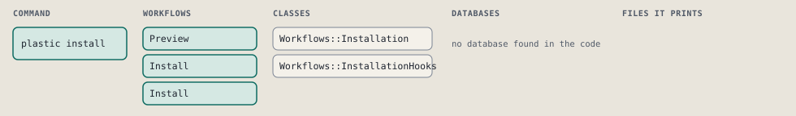
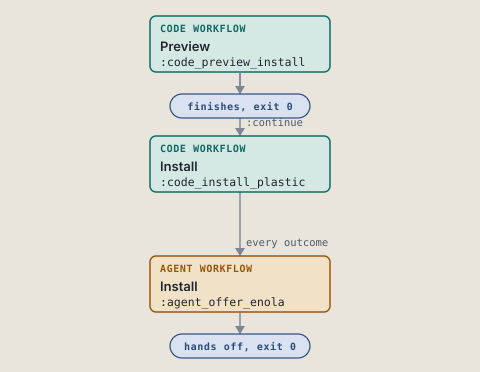
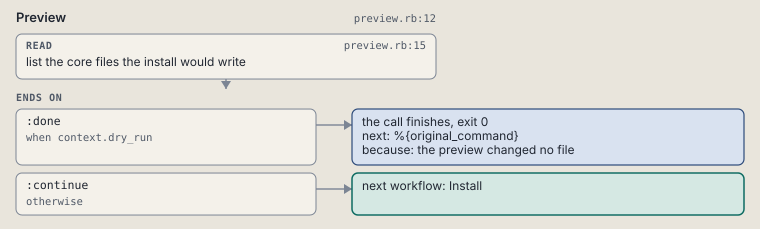
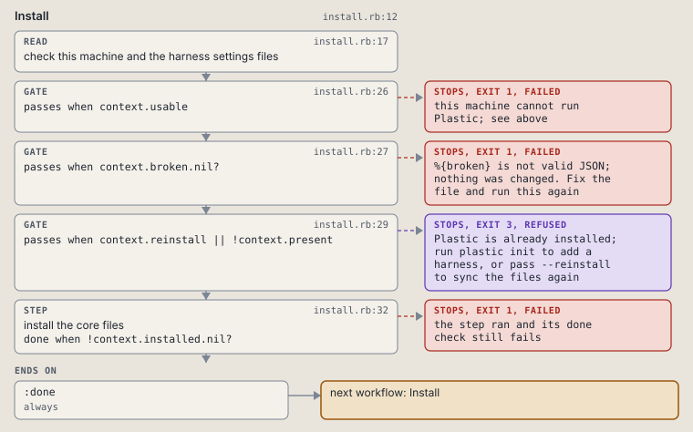
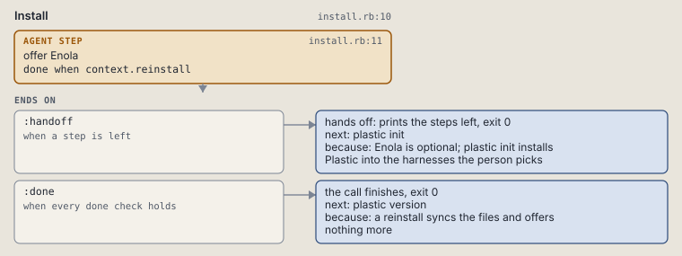
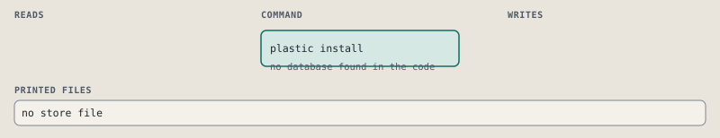

# plastic install

Install the core files and make the global store.

Copies the core files of the running package into the home and makes the global store. `plastic init` installs Plastic into the harnesses.

```sh
plastic install [--reinstall] [--force] [--dry-run]
```

The command is `Install`, in [`install.rb:9`](../../../../lib/plastic/commands/install.rb#L9). The words on this page, such as gate, step and outcome, are explained in [the command DSL](../../dsl/README.md).

| Argument or option | What it gives | Default |
| --- | --- | --- |
| `--reinstall` | sync the files again and make the global store and local.db when they are missing or behind | `false` |
| `--force` | replace agent files Plastic did not write | `false` |
| `--dry-run` | list what would change and change nothing | `false` |

## Components



The figure shows the command, the workflows it runs, the classes behind them, and the databases and files they reach.

## The events of one call



| Workflow | Kind | Code |
| --- | --- | --- |
| [Code::Install::Preview](#codeinstallpreview) | code | [`preview.rb:12`](../../../../lib/plastic/workflows/code/install/preview.rb#L12) |
| [Code::Install](#codeinstall) | code | [`install.rb:12`](../../../../lib/plastic/workflows/code/install.rb#L12) |
| [Agent::Install](#agentinstall) | agent | [`install.rb:10`](../../../../lib/plastic/workflows/agent/install.rb#L10) |

### Code::Install::Preview

The code workflow `:code_preview_install`, in [`preview.rb:12`](../../../../lib/plastic/workflows/code/install/preview.rb#L12).

On a dry run, lists each core file the install would add or replace.



Its rows run in this order:

1. Read: list the core files the install would write. [`preview.rb:15`](../../../../lib/plastic/workflows/code/install/preview.rb#L15)
2. Outcome `:done`, when `context.dry_run`: finishes with exit 0; next: ORIGINAL_COMMAND. [`preview.rb:23`](../../../../lib/plastic/workflows/code/install/preview.rb#L23)
3. Outcome `:continue`, otherwise: starts the workflow [Code::Install](#codeinstall). [`preview.rb:25`](../../../../lib/plastic/workflows/code/install/preview.rb#L25)

### Code::Install

The code workflow `:code_install_plastic`, in [`install.rb:12`](../../../../lib/plastic/workflows/code/install.rb#L12).

Checks the machine, then copies the core files into the home. A reinstall also syncs the harnesses Plastic is installed into.



Its rows run in this order:

1. Read: check this machine and the harness settings files. [`install.rb:17`](../../../../lib/plastic/workflows/code/install.rb#L17)
2. Gate: passes when `context.usable`; otherwise the call stops with exit 1 and prints this machine cannot run Plastic; see above. [`install.rb:26`](../../../../lib/plastic/workflows/code/install.rb#L26)
3. Gate: passes when `context.broken.nil?`; otherwise the call stops with exit 1 and prints BROKEN is not valid JSON; nothing was changed. Fix the file and run this again. [`install.rb:27`](../../../../lib/plastic/workflows/code/install.rb#L27)
4. Gate: passes when `context.reinstall || !context.present`; otherwise the call stops with exit 3 and prints Plastic is already installed; run plastic init to add a harness, or pass --reinstall to sync the files again. [`install.rb:29`](../../../../lib/plastic/workflows/code/install.rb#L29)
5. Step: install the core files. Done when `!context.installed.nil?`, so a second call skips it. [`install.rb:32`](../../../../lib/plastic/workflows/code/install.rb#L32)
6. Outcome `:done`, always: starts the workflow [Agent::Install](#agentinstall). [`install.rb:40`](../../../../lib/plastic/workflows/code/install.rb#L40)

It sets `usable`, `broken`, `present`, `installed`.

### Agent::Install

The agent workflow `:agent_offer_enola`, in [`install.rb:10`](../../../../lib/plastic/workflows/agent/install.rb#L10).

After a first install, the agent may offer Enola to the person. Plastic runs no Enola installer and keeps no answer, so a reinstall offers nothing.



Its rows run in this order:

1. Agent step: offer Enola. Done when `context.reinstall`, while it fails, the call prints its `say:` text. [`install.rb:11`](../../../../lib/plastic/workflows/agent/install.rb#L11)
2. Outcome `:handoff`, when a step is left: hands off with exit 0; next: plastic init. [`install.rb:15`](../../../../lib/plastic/workflows/agent/install.rb#L15)
3. Outcome `:done`, when every done check holds: finishes with exit 0; next: plastic version. [`install.rb:16`](../../../../lib/plastic/workflows/agent/install.rb#L16)

The agent step "offer Enola" prints:

> Enola maps the code architecture of a project. It is optional: Plastic works without it. To install it, run its official installer: curl -fsSL https://raw.githubusercontent.com/enola-labs/enola/main/install.sh | sh

While a step is left, the call hands off with exit 0 from `:handoff`: it prints the `say:` text of each failing step and offers next: plastic init. The command writes nothing, so the call keeps no routine run row. The next call starts fresh and checks the steps again.

In the words of workflow engines, the rows are these four parts:

- **Trigger**: the call starts the workflow `Code::Install::Preview`; each later workflow starts from an outcome of the one before it.
- **Activities**: 2 reads, 1 step and 1 agent step.
- **Transitions**: 3 gates stop the call when their checks fail; a step runs only while its done check fails; Preview goes to Install on `:continue`; Install goes to Install on every outcome.
- **Outcomes**: `:done` of Preview, `:handoff` of Install, `:done` of Install end the call.

## What one call reads, writes and prints



It reads and writes no store database and prints no store file.

A second call runs the same rows again. A step runs again only when its done check fails.

| Step | Done when | The second call | Code |
| --- | --- | --- | --- |
| install the core files | `!context.installed.nil?` | skips it | [`install.rb:32`](../../../../lib/plastic/workflows/code/install.rb#L32) |
| offer Enola | `context.reinstall` | skips it | [`install.rb:11`](../../../../lib/plastic/workflows/agent/install.rb#L11) |

## How a call ends

Every call can also end in [the ways any call can end](../../dsl/README.md#how-any-call-can-end).

| Ending | Exit | next: | Code |
| --- | --- | --- | --- |
| the preview changed no file | 0 | ORIGINAL_COMMAND | [`preview.rb:23`](../../../../lib/plastic/workflows/code/install/preview.rb#L23) |
| this machine cannot run Plastic; see above | 1 | prints no next: line | [`install.rb:26`](../../../../lib/plastic/workflows/code/install.rb#L26) |
| BROKEN is not valid JSON; nothing was changed. Fix the file and run this again | 1 | prints no next: line | [`install.rb:27`](../../../../lib/plastic/workflows/code/install.rb#L27) |
| Plastic is already installed; run plastic init to add a harness, or pass --reinstall to sync the files again | 3 | prints no next: line | [`install.rb:29`](../../../../lib/plastic/workflows/code/install.rb#L29) |
| Enola is optional; plastic init installs Plastic into the harnesses the person picks | 0 | plastic init | [`install.rb:15`](../../../../lib/plastic/workflows/agent/install.rb#L15) |
| a reinstall syncs the files and offers nothing more | 0 | plastic version | [`install.rb:16`](../../../../lib/plastic/workflows/agent/install.rb#L16) |
| a step raises | 1 | prints no next: line | [`code_workflow.rb:102`](../../../../lib/plastic/code_workflow.rb#L102) |

## What the page leaves out

Every call shares a few things that this page does not repeat; [the command DSL](../../dsl/README.md#what-every-call-shares) names them.
