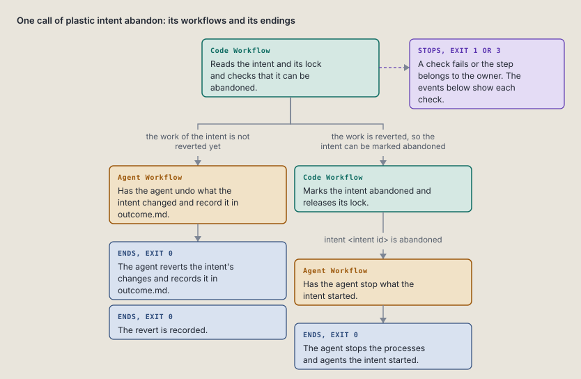
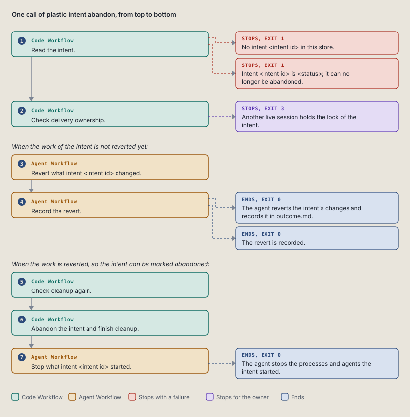

# plastic intent abandon

Close an intent that will not ship once outcome.md records the revert, or print the revert steps.

```sh
plastic intent abandon ID
```

| Argument or option | What it gives | Default |
| --- | --- | --- |
| `ID` | the intent | |

## The workflows of one call



Each box is a workflow. The words between the boxes say when the call moves on, and the last boxes say how the call ends.

## The events of one call, step by step



The boxes on the left run in order. The boxes on the right are the ways the call stops or ends at that step.

## What one call changes

| What changes | Where | Reach |
| --- | --- | --- |
| The intent is marked abandoned | the work graph database, in the store folder | goes with the store |
| The lock of the intent is released | the local database, in the home folder | stays on this machine |
| The index of the store is rewritten | the store folder | goes with the store |

Goes with the store: the files of the store carry the change, and `plastic sync up` rebuilds it on another machine. The database files themselves stay on this machine.

## What the agent workflow steps print

| Step | The text the agent gets |
| --- | --- |
| 3 | Use version control as the project's AGENTS.md or CLAUDE.md defines it, or as the project's history shows when neither does: undo what intent \<intent id> changed, close or delete its branch and worktree, and revert any commit that reached the base. Plastic runs no version control command; it records what you write. |
| 4 | Write in \<intent folder>/outcome.md why the intent is dropped, and add the line '- Reverted: \<what was undone, or nothing delivered>' under ## Verification. Run plastic sync up and then plastic intent abandon \<intent id> again. |
| 7 | Stop the processes and the agents that intent \<intent id> started: servers, watchers, background jobs and subagents. Plastic runs none of them and stops none of them. |

The command is `Plastic::Commands::Intent::Abandon`, in [`abandon.rb:9`](../../../../lib/plastic/commands/intent/abandon.rb#L9).
