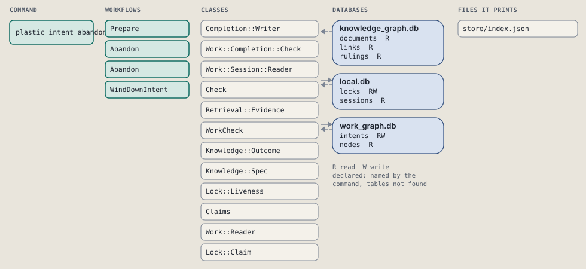
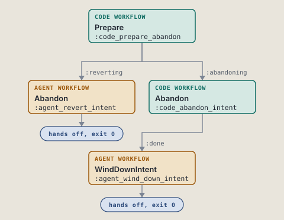
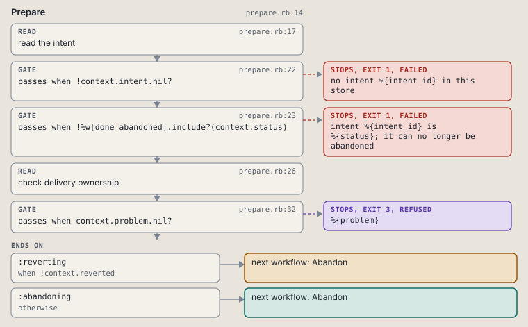
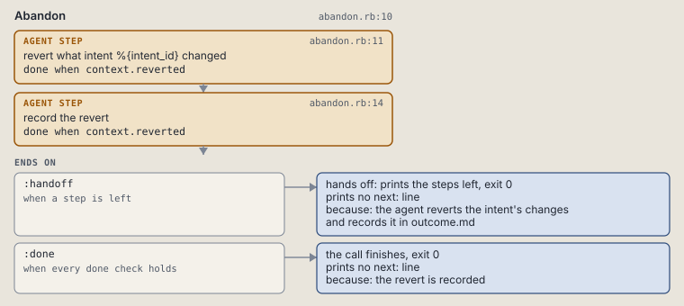
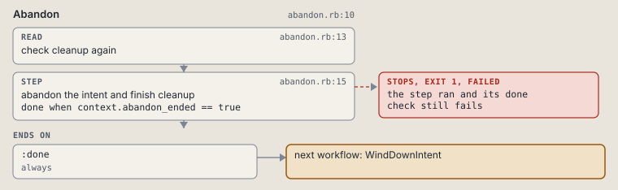
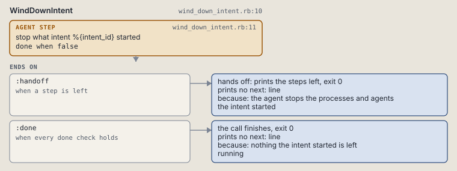
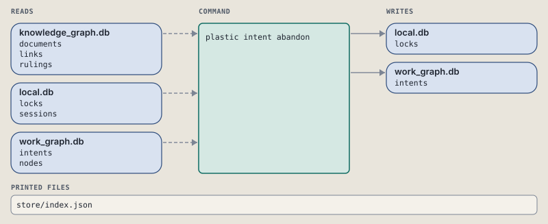

# plastic intent abandon

Close an intent that will not ship once outcome.md records the revert, or print the revert steps.

```sh
plastic intent abandon ID
```

The command is `Intent::Abandon`, in [`abandon.rb:9`](../../../../lib/plastic/commands/intent/abandon.rb#L9). The words on this page, such as gate, step and outcome, are explained in [the command DSL](../../dsl/README.md).

| Argument or option | What it gives | Default |
| --- | --- | --- |
| `ID` | the intent | |

## Components



The figure shows the command, the workflows it runs, the classes behind them, and the databases and files they reach.

## The events of one call



| Workflow | Kind | Code |
| --- | --- | --- |
| [Code::Intent::Abandon::Prepare](#codeintentabandonprepare) | code | [`prepare.rb:14`](../../../../lib/plastic/workflows/code/intent/abandon/prepare.rb#L14) |
| [Agent::Intent::Abandon](#agentintentabandon) | agent | [`abandon.rb:10`](../../../../lib/plastic/workflows/agent/intent/abandon.rb#L10) |
| [Code::Intent::Abandon](#codeintentabandon) | code | [`abandon.rb:10`](../../../../lib/plastic/workflows/code/intent/abandon.rb#L10) |
| [Agent::Shared::WindDownIntent](#agentsharedwinddownintent) | agent | [`wind_down_intent.rb:10`](../../../../lib/plastic/workflows/agent/shared/wind_down_intent.rb#L10) |

### Code::Intent::Abandon::Prepare

The code workflow `:code_prepare_abandon`, in [`prepare.rb:14`](../../../../lib/plastic/workflows/code/intent/abandon/prepare.rb#L14).

Reads the intent and its lock: a missing or closed intent fails, a foreign live lock refuses, and an outcome without a Reverted line hands over the revert steps.



Its rows run in this order:

1. Read: read the intent. [`prepare.rb:17`](../../../../lib/plastic/workflows/code/intent/abandon/prepare.rb#L17)
2. Gate: passes when `!context.intent.nil?`; otherwise the call stops with exit 1 and prints no intent INTENT_ID in this store. [`prepare.rb:22`](../../../../lib/plastic/workflows/code/intent/abandon/prepare.rb#L22)
3. Gate: passes when `!%w[done abandoned].include?(context.status)`; otherwise the call stops with exit 1 and prints intent INTENT_ID is STATUS; it can no longer be abandoned. [`prepare.rb:23`](../../../../lib/plastic/workflows/code/intent/abandon/prepare.rb#L23)
4. Read: check delivery ownership. [`prepare.rb:26`](../../../../lib/plastic/workflows/code/intent/abandon/prepare.rb#L26)
5. Gate: passes when `context.problem.nil?`; otherwise the call stops with exit 3 and prints PROBLEM. [`prepare.rb:32`](../../../../lib/plastic/workflows/code/intent/abandon/prepare.rb#L32)
6. Outcome `:reverting`, when `!context.reverted`: starts the workflow [Agent::Intent::Abandon](#agentintentabandon). [`prepare.rb:34`](../../../../lib/plastic/workflows/code/intent/abandon/prepare.rb#L34)
7. Outcome `:abandoning`, otherwise: starts the workflow [Code::Intent::Abandon](#codeintentabandon). [`prepare.rb:35`](../../../../lib/plastic/workflows/code/intent/abandon/prepare.rb#L35)

It sets `intent`, `status`, `problem`, `intent_folder`, `reverted`.

### Agent::Intent::Abandon

The agent workflow `:agent_revert_intent`, in [`abandon.rb:10`](../../../../lib/plastic/workflows/agent/intent/abandon.rb#L10).

The agent undoes what the intent changed and records that in outcome.md. Plastic runs no version control command.



Its rows run in this order:

1. Agent step: revert what intent INTENT_ID changed. Done when `context.reverted`, while it fails, the call prints its `say:` text. [`abandon.rb:11`](../../../../lib/plastic/workflows/agent/intent/abandon.rb#L11)
2. Agent step: record the revert. Done when `context.reverted`, while it fails, the call prints its `say:` text. [`abandon.rb:14`](../../../../lib/plastic/workflows/agent/intent/abandon.rb#L14)
3. Outcome `:handoff`, when a step is left: hands off with exit 0; prints no next: line. [`abandon.rb:18`](../../../../lib/plastic/workflows/agent/intent/abandon.rb#L18)
4. Outcome `:done`, when every done check holds: finishes with exit 0; prints no next: line. [`abandon.rb:19`](../../../../lib/plastic/workflows/agent/intent/abandon.rb#L19)

The agent step "revert what intent INTENT_ID changed" prints:

> Undo what intent INTENT_ID changed with your own version control tool: close or delete its branch and worktree, and revert any commit that reached the base. Plastic runs no version control command; it records what you write.

The agent step "record the revert" prints:

> Write in INTENT_FOLDER/outcome.md why the intent is dropped, and add the line '- Reverted: <what was undone, or nothing delivered>' under ## Verification. Run plastic sync up and then plastic intent abandon INTENT_ID again.

While a step is left, the call hands off with exit 0 from `:handoff`: it prints the `say:` text of each failing step and prints no next: line. The command writes, so the call keeps its routine run row in local.db. The next call loads its facts, restarts at the first workflow and skips each step whose `done:` check holds.

### Code::Intent::Abandon

The code workflow `:code_abandon_intent`, in [`abandon.rb:10`](../../../../lib/plastic/workflows/code/intent/abandon.rb#L10).

The abandoned close can be retried after the status write but before lock cleanup.



Its rows run in this order:

1. Read: check cleanup again. [`abandon.rb:13`](../../../../lib/plastic/workflows/code/intent/abandon.rb#L13)
2. Step: abandon the intent and finish cleanup. Done when `context.abandon_ended == true`, so a second call skips it. [`abandon.rb:15`](../../../../lib/plastic/workflows/code/intent/abandon.rb#L15)
3. Outcome `:done`, always: starts the workflow [Agent::Shared::WindDownIntent](#agentsharedwinddownintent). [`abandon.rb:21`](../../../../lib/plastic/workflows/code/intent/abandon.rb#L21)

It sets `abandon_ended`.

### Agent::Shared::WindDownIntent

The agent workflow `:agent_wind_down_intent`, in [`wind_down_intent.rb:10`](../../../../lib/plastic/workflows/agent/shared/wind_down_intent.rb#L10).

The agent stops what the intent started. Plastic runs and stops nothing.



Its rows run in this order:

1. Agent step: stop what intent INTENT_ID started. Runs on every call; its done check is `false`. The call prints its `say:` text. [`wind_down_intent.rb:11`](../../../../lib/plastic/workflows/agent/shared/wind_down_intent.rb#L11)
2. Outcome `:handoff`, when a step is left: hands off with exit 0; prints no next: line. [`wind_down_intent.rb:15`](../../../../lib/plastic/workflows/agent/shared/wind_down_intent.rb#L15)
3. Outcome `:done`, when every done check holds: finishes with exit 0; prints no next: line. [`wind_down_intent.rb:16`](../../../../lib/plastic/workflows/agent/shared/wind_down_intent.rb#L16)

The agent step "stop what intent INTENT_ID started" prints:

> Stop the processes and the agents that intent INTENT_ID started: servers, watchers, background jobs and subagents. Plastic runs none of them and stops none of them.

While a step is left, the call hands off with exit 0 from `:handoff`: it prints the `say:` text of each failing step and prints no next: line. The command writes, so the call keeps its routine run row in local.db. The next call loads its facts, restarts at the first workflow and skips each step whose `done:` check holds.

In the words of workflow engines, the rows are these four parts:

- **Trigger**: the call starts the workflow `Code::Intent::Abandon::Prepare`; each later workflow starts from an outcome of the one before it.
- **Activities**: 3 reads, 1 step and 3 agent steps.
- **Transitions**: 3 gates stop the call when their checks fail; a step runs only while its done check fails; Prepare goes to Abandon on `:reverting`; Prepare goes to Abandon on `:abandoning`; Abandon goes to WindDownIntent on `:done`.
- **Outcomes**: `:handoff` of Abandon, `:done` of Abandon, `:handoff` of WindDownIntent, `:done` of WindDownIntent end the call.

## What one call reads, writes and prints



| Place | Database or file | Tables | Reads or writes | Code |
| --- | --- | --- | --- | --- |
| the store folder | knowledge_graph.db | `documents`, `links`, `rulings` | reads | [`abandon.rb:13`](../../../../lib/plastic/commands/intent/abandon.rb#L13) |
| the home folder | local.db | `locks`, `sessions` | reads and writes | found in the code, not declared |
| the store folder | work_graph.db | `intents`, `nodes` | reads and writes | [`abandon.rb:11`](../../../../lib/plastic/commands/intent/abandon.rb#L11) |
| the store folder | store/index.json | | writes | [`prints.rb:14`](../../../../lib/plastic/graph/prints.rb#L14) |

A second call runs the same rows again. A step runs again only when its done check fails.

| Step | Done when | The second call | Code |
| --- | --- | --- | --- |
| revert what intent INTENT_ID changed | `context.reverted` | skips it | [`abandon.rb:11`](../../../../lib/plastic/workflows/agent/intent/abandon.rb#L11) |
| record the revert | `context.reverted` | skips it | [`abandon.rb:14`](../../../../lib/plastic/workflows/agent/intent/abandon.rb#L14) |
| abandon the intent and finish cleanup | `context.abandon_ended == true` | skips it | [`abandon.rb:15`](../../../../lib/plastic/workflows/code/intent/abandon.rb#L15) |
| stop what intent INTENT_ID started | `false` | runs it again | [`wind_down_intent.rb:11`](../../../../lib/plastic/workflows/agent/shared/wind_down_intent.rb#L11) |

## How a call ends

Every call can also end in [the ways any call can end](../../dsl/README.md#how-any-call-can-end).

| Ending | Exit | next: | Code |
| --- | --- | --- | --- |
| no intent INTENT_ID in this store | 1 | prints no next: line | [`prepare.rb:22`](../../../../lib/plastic/workflows/code/intent/abandon/prepare.rb#L22) |
| intent INTENT_ID is STATUS; it can no longer be abandoned | 1 | prints no next: line | [`prepare.rb:23`](../../../../lib/plastic/workflows/code/intent/abandon/prepare.rb#L23) |
| PROBLEM | 3 | prints no next: line | [`prepare.rb:32`](../../../../lib/plastic/workflows/code/intent/abandon/prepare.rb#L32) |
| the agent reverts the intent's changes and records it in outcome.md | 0 | prints no next: line | [`abandon.rb:18`](../../../../lib/plastic/workflows/agent/intent/abandon.rb#L18) |
| the revert is recorded | 0 | prints no next: line | [`abandon.rb:19`](../../../../lib/plastic/workflows/agent/intent/abandon.rb#L19) |
| the agent stops the processes and agents the intent started | 0 | prints no next: line | [`wind_down_intent.rb:15`](../../../../lib/plastic/workflows/agent/shared/wind_down_intent.rb#L15) |
| nothing the intent started is left running | 0 | prints no next: line | [`wind_down_intent.rb:16`](../../../../lib/plastic/workflows/agent/shared/wind_down_intent.rb#L16) |
| a step raises | 1 | prints no next: line | [`code_workflow.rb:102`](../../../../lib/plastic/code_workflow.rb#L102) |

## What the page leaves out

Every call shares a few things that this page does not repeat; [the command DSL](../../dsl/README.md#what-every-call-shares) names them.

- A call that writes saves a routine run row in local.db. A stop by a gate or a step saves the run, and the next call resumes from it. A dry run saves no row.
