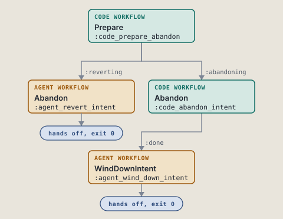

# plastic intent abandon

Close an intent that will not ship once outcome.md records the revert, or print the revert steps.

```sh
plastic intent abandon ID
```

The command is `Intent::Abandon`, in [`abandon.rb:9`](../../../../lib/plastic/commands/intent/abandon.rb#L9). The words on this page, such as gate, step and outcome, are explained in [the command DSL](../../dsl/README.md).

| Argument or option | What it gives | Default |
| --- | --- | --- |
| `ID` | the intent | |

## What it touches


## How the call flows



| Workflow | Kind | Code |
| --- | --- | --- |
| [Code::Intent::Abandon::Prepare](#codeintentabandonprepare) | code | [`prepare.rb:14`](../../../../lib/plastic/workflows/code/intent/abandon/prepare.rb#L14) |
| [Agent::Intent::Abandon](#agentintentabandon) | agent | [`abandon.rb:10`](../../../../lib/plastic/workflows/agent/intent/abandon.rb#L10) |
| [Code::Intent::Abandon](#codeintentabandon) | code | [`abandon.rb:10`](../../../../lib/plastic/workflows/code/intent/abandon.rb#L10) |
| [Agent::Shared::WindDownIntent](#agentsharedwinddownintent) | agent | [`wind_down_intent.rb:10`](../../../../lib/plastic/workflows/agent/shared/wind_down_intent.rb#L10) |

### Code::Intent::Abandon::Prepare

The code workflow `:code_prepare_abandon`, in [`prepare.rb:14`](../../../../lib/plastic/workflows/code/intent/abandon/prepare.rb#L14).

Reads the intent and its lock: a missing or closed intent fails, a foreign live lock refuses, and an outcome without a Reverted line hands over the revert steps.


| Step | Kind | Check | Code |
| --- | --- | --- | --- |
| read the intent | read |  | [`prepare.rb:17`](../../../../lib/plastic/workflows/code/intent/abandon/prepare.rb#L17) |
| no intent %{intent_id} in this store | gate, stops with exit 1 | `!context.intent.nil?` | [`prepare.rb:22`](../../../../lib/plastic/workflows/code/intent/abandon/prepare.rb#L22) |
| intent %{intent_id} is %{status}; it can no longer be abandoned | gate, stops with exit 1 | `!%w[done abandoned].include?(context.status)` | [`prepare.rb:23`](../../../../lib/plastic/workflows/code/intent/abandon/prepare.rb#L23) |
| check delivery ownership | read |  | [`prepare.rb:26`](../../../../lib/plastic/workflows/code/intent/abandon/prepare.rb#L26) |
| %{problem} | gate, stops with exit 3 | `context.problem.nil?` | [`prepare.rb:32`](../../../../lib/plastic/workflows/code/intent/abandon/prepare.rb#L32) |

| Outcome | When | Then | Code |
| --- | --- | --- | --- |
| `:reverting` | when `!context.reverted` | runs [Agent::Intent::Abandon](#agentintentabandon) | [`prepare.rb:34`](../../../../lib/plastic/workflows/code/intent/abandon/prepare.rb#L34) |
| `:abandoning` | otherwise | runs [Code::Intent::Abandon](#codeintentabandon) | [`prepare.rb:35`](../../../../lib/plastic/workflows/code/intent/abandon/prepare.rb#L35) |

It sets `intent`, `status`, `problem`, `intent_folder`, `reverted`.

### Agent::Intent::Abandon

The agent workflow `:agent_revert_intent`, in [`abandon.rb:10`](../../../../lib/plastic/workflows/agent/intent/abandon.rb#L10).

The agent undoes what the intent changed and records that in outcome.md. Plastic runs no version control command.


| Step | Kind | Check | Code |
| --- | --- | --- | --- |
| revert what intent %{intent_id} changed | agent step | `context.reverted` | [`abandon.rb:11`](../../../../lib/plastic/workflows/agent/intent/abandon.rb#L11) |
| record the revert | agent step | `context.reverted` | [`abandon.rb:14`](../../../../lib/plastic/workflows/agent/intent/abandon.rb#L14) |

| Outcome | When | Then | Code |
| --- | --- | --- | --- |
| `:handoff` | when a step is left | hands off, exit 0; prints no next: line | [`abandon.rb:18`](../../../../lib/plastic/workflows/agent/intent/abandon.rb#L18) |
| `:done` | when every done check holds | finishes, exit 0; prints no next: line | [`abandon.rb:19`](../../../../lib/plastic/workflows/agent/intent/abandon.rb#L19) |

The agent step "revert what intent %{intent_id} changed" prints:

> Undo what intent %{intent_id} changed with your own version control tool: close or delete its branch and worktree, and revert any commit that reached the base. Plastic runs no version control command; it records what you write.

The agent step "record the revert" prints:

> Write in %{intent_folder}/outcome.md why the intent is dropped, and add the line '- Reverted: <what was undone, or nothing delivered>' under ## Verification. Run plastic sync up and then plastic intent abandon %{intent_id} again.

### Code::Intent::Abandon

The code workflow `:code_abandon_intent`, in [`abandon.rb:10`](../../../../lib/plastic/workflows/code/intent/abandon.rb#L10).

The abandoned close can be retried after the status write but before lock cleanup.


| Step | Kind | Check | Code |
| --- | --- | --- | --- |
| check cleanup again | read |  | [`abandon.rb:13`](../../../../lib/plastic/workflows/code/intent/abandon.rb#L13) |
| abandon the intent and finish cleanup | step | `context.abandon_ended == true` | [`abandon.rb:15`](../../../../lib/plastic/workflows/code/intent/abandon.rb#L15) |

| Outcome | When | Then | Code |
| --- | --- | --- | --- |
| `:done` | always | runs [Agent::Shared::WindDownIntent](#agentsharedwinddownintent) | [`abandon.rb:21`](../../../../lib/plastic/workflows/code/intent/abandon.rb#L21) |

It sets `abandon_ended`.

### Agent::Shared::WindDownIntent

The agent workflow `:agent_wind_down_intent`, in [`wind_down_intent.rb:10`](../../../../lib/plastic/workflows/agent/shared/wind_down_intent.rb#L10).

The agent stops what the intent started. Plastic runs and stops nothing.


| Step | Kind | Check | Code |
| --- | --- | --- | --- |
| stop what intent %{intent_id} started | agent step | `false` | [`wind_down_intent.rb:11`](../../../../lib/plastic/workflows/agent/shared/wind_down_intent.rb#L11) |

| Outcome | When | Then | Code |
| --- | --- | --- | --- |
| `:handoff` | when a step is left | hands off, exit 0; prints no next: line | [`wind_down_intent.rb:15`](../../../../lib/plastic/workflows/agent/shared/wind_down_intent.rb#L15) |
| `:done` | when every done check holds | finishes, exit 0; prints no next: line | [`wind_down_intent.rb:16`](../../../../lib/plastic/workflows/agent/shared/wind_down_intent.rb#L16) |

The agent step "stop what intent %{intent_id} started" prints:

> Stop the processes and the agents that intent %{intent_id} started: servers, watchers, background jobs and subagents. Plastic runs none of them and stops none of them.

## Outcomes

Every call can also end in [the ways any call can end](../../dsl/README.md#how-any-call-can-end).

| Ending | Exit | next: | Code |
| --- | --- | --- | --- |
| no intent %{intent_id} in this store | 1 | prints no next: line | [`prepare.rb:22`](../../../../lib/plastic/workflows/code/intent/abandon/prepare.rb#L22) |
| intent %{intent_id} is %{status}; it can no longer be abandoned | 1 | prints no next: line | [`prepare.rb:23`](../../../../lib/plastic/workflows/code/intent/abandon/prepare.rb#L23) |
| %{problem} | 3 | prints no next: line | [`prepare.rb:32`](../../../../lib/plastic/workflows/code/intent/abandon/prepare.rb#L32) |
| the agent reverts the intent's changes and records it in outcome.md | 0 | prints no next: line | [`abandon.rb:18`](../../../../lib/plastic/workflows/agent/intent/abandon.rb#L18) |
| the revert is recorded | 0 | prints no next: line | [`abandon.rb:19`](../../../../lib/plastic/workflows/agent/intent/abandon.rb#L19) |
| the agent stops the processes and agents the intent started | 0 | prints no next: line | [`wind_down_intent.rb:15`](../../../../lib/plastic/workflows/agent/shared/wind_down_intent.rb#L15) |
| nothing the intent started is left running | 0 | prints no next: line | [`wind_down_intent.rb:16`](../../../../lib/plastic/workflows/agent/shared/wind_down_intent.rb#L16) |
| a step raises | 1 | prints no next: line | [`code_workflow.rb:102`](../../../../lib/plastic/code_workflow.rb#L102) |
