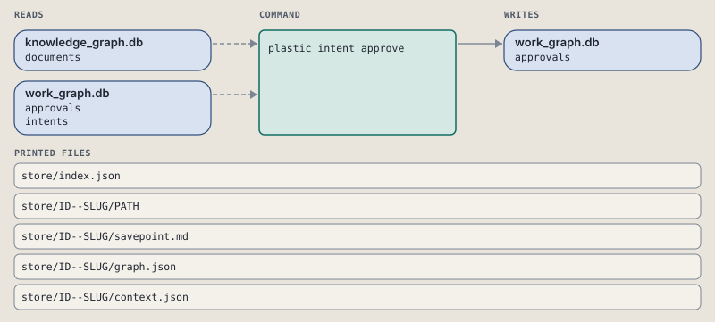

# plastic intent approve

Write the owner's go-ahead for an intent; auto refuses an intent without it.

```sh
plastic intent approve ID
```

The command is `Intent::Approve`, in [`approve.rb:9`](../../../../lib/plastic/commands/intent/approve.rb#L9). The words on this page, such as gate, step and outcome, are explained in [the command DSL](../../dsl/README.md).

| Argument or option | What it gives | Default |
| --- | --- | --- |
| `ID` | the intent | |

## Components


The figure shows the command, the workflows it runs, the classes behind them, and the databases and files they reach.

## The events of one call

The call starts the workflow `Code::Intent::Approve`, in [`approve.rb:11`](../../../../lib/plastic/workflows/code/intent/approve.rb#L11).

Writes the go-ahead row of an open or active intent. A second call changes nothing.


Its rows run in this order:

1. Read: check the intent. [`approve.rb:16`](../../../../lib/plastic/workflows/code/intent/approve.rb#L16)
2. Gate: passes when `context.problem.nil?`; otherwise the call stops with exit 1 and prints PROBLEM. [`approve.rb:20`](../../../../lib/plastic/workflows/code/intent/approve.rb#L20)
3. Gate: passes when `!Plastic::Graph::Knowledge::Spec.new(context.retrieval, context.intent_id).done_criteria.empty?`; otherwise the call stops with exit 1 and prints intent INTENT_ID names no done criterion. [`approve.rb:22`](../../../../lib/plastic/workflows/code/intent/approve.rb#L22)
4. Step: write the go-ahead. Done when `!context.retrieval.approval(context.intent_id).nil?`, so a second call skips it. [`approve.rb:26`](../../../../lib/plastic/workflows/code/intent/approve.rb#L26)
5. Read: say what was written. [`approve.rb:30`](../../../../lib/plastic/workflows/code/intent/approve.rb#L30)
6. Outcome `:done`, always: finishes with exit 0; next: plastic auto INTENT_ID. [`approve.rb:34`](../../../../lib/plastic/workflows/code/intent/approve.rb#L34)

It sets `problem`.

In the words of workflow engines, the rows are these four parts:

- **Trigger**: the call starts the workflow `Code::Intent::Approve`.
- **Activities**: 2 reads and 1 step.
- **Transitions**: 2 gates stop the call when their checks fail; a step runs only while its done check fails.
- **Outcomes**: `:done` ends the call.

## What one call reads, writes and prints



| Place | Database or file | Tables | Reads or writes | Code |
| --- | --- | --- | --- | --- |
| the store folder | knowledge_graph.db | `documents` | reads | [`approve.rb:11`](../../../../lib/plastic/commands/intent/approve.rb#L11) |
| the store folder | work_graph.db | `approvals`, `intents` | reads and writes | [`approve.rb:12`](../../../../lib/plastic/commands/intent/approve.rb#L12) |
| the store folder | store/index.json | | writes | [`prints.rb:14`](../../../../lib/plastic/graph/prints.rb#L14) |
| the store folder | store/ID--SLUG/PATH | | writes | [`prints.rb:15`](../../../../lib/plastic/graph/prints.rb#L15) |
| the store folder | store/ID--SLUG/savepoint.md | | writes | [`prints.rb:16`](../../../../lib/plastic/graph/prints.rb#L16) |
| the store folder | store/ID--SLUG/graph.json | | writes | [`prints.rb:17`](../../../../lib/plastic/graph/prints.rb#L17) |
| the store folder | store/ID--SLUG/context.json | | writes | [`prints.rb:18`](../../../../lib/plastic/graph/prints.rb#L18) |

A second call runs the same rows again. A step runs again only when its done check fails.

| Step | Done when | The second call | Code |
| --- | --- | --- | --- |
| write the go-ahead | `!context.retrieval.approval(context.intent_id).nil?` | skips it | [`approve.rb:26`](../../../../lib/plastic/workflows/code/intent/approve.rb#L26) |

## How a call ends

Every call can also end in [the ways any call can end](../../dsl/README.md#how-any-call-can-end).

| Ending | Exit | next: | Code |
| --- | --- | --- | --- |
| PROBLEM | 1 | prints no next: line | [`approve.rb:20`](../../../../lib/plastic/workflows/code/intent/approve.rb#L20) |
| intent INTENT_ID names no done criterion | 1 | plastic intent spec INTENT_ID | [`approve.rb:22`](../../../../lib/plastic/workflows/code/intent/approve.rb#L22) |
| intent INTENT_ID has the owner's go-ahead | 0 | plastic auto INTENT_ID | [`approve.rb:34`](../../../../lib/plastic/workflows/code/intent/approve.rb#L34) |
| a step raises | 1 | prints no next: line | [`code_workflow.rb:102`](../../../../lib/plastic/code_workflow.rb#L102) |

## What the page leaves out

Every call shares a few things that this page does not repeat; [the command DSL](../../dsl/README.md#what-every-call-shares) names them.

- No gate of this command refuses, so exit 3 never happens.
- A call that writes saves a routine run row in local.db. A stop by a gate or a step saves the run, and the next call resumes from it. A dry run saves no row.
